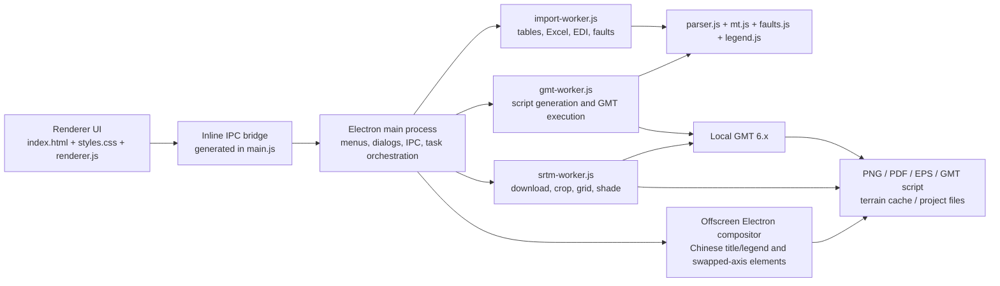

# MT点位图制作工具—GMT 项目接手指南 / Project Handoff Guide

> 最后核对日期 / Last verified: 2026-09-11 ｜ 正式产品线 / Primary product line: Electron + Node.js + GMT 6.x ｜ 本文用途 / Purpose: 让新开发者不依赖历史聊天记录即可继续开发、测试、打包和发布。

## 2026-09-11 v1.14.0 直接导出 AI（已安装并后台重启）

- 新按钮：导出图件 → 直接导出 AI（.ai），真实传入 formats:["ai"]；main 转为 GMT PDF 工作流，生成完整文字编辑包，再通过异步 Illustrator 桥接保存原生 AI。保留手动 AI 编辑包，不以重命名 PDF 代替原生 AI。
- electron/illustrator-direct.js：macOS Launch Services 查找 Illustrator、osascript 后台调用；Windows reg 检查 COM 注册、UTF-16 VBScript 调用 Illustrator.Application.DoJavaScriptFile。支持缺失软件、权限拒绝、失败、无效结果提示和协作取消；不强杀 Illustrator。Windows 尚未实机验证。
- JSX 自动模式独立于 GMT_QA，保存完成后关闭本次文档、恢复原有文档及 PDF 页码/交互设置，返回实际输出路径；已存在同名 AI 时追加时间标记。中间包保存在全局目录/临时文件/ai-export-*/，实际 AI 在区域导出目录。失败包保留，取消由文件标记协作完成。
- macOS 包增加 NSAppleEventsUsageDescription 和 automation.apple-events 权限，保留 Electron JIT/内存/库验证权限。首次自动化仍可能需要用户在系统对话框允许。
- 19 组 npm run test:node 全通过。真实隐藏 Electron/GMT/Illustrator 直接导出（含合成地形和透明区域）、原论文工程、候选 ASAR、空标注空图例场景通过；实际按钮点击捕获为 ["ai"], true。取消测试未生成目标 AI、用户原文档不变。
- 原论文工程重新打开 AI：200 paths、23 textFrames、1 raster、5 个命名图层；Qulong 整段文字可编辑并独立移动，恢复后关闭。导出前后用户文档及设置一致。AI 预览已目视检查；地形保持影像，线条与文字保持可编辑。
- 验证文件：全局目录/验证/v1.14.0/原工程/publication-results.json、AI重开验证.txt、AI预览.png。PDF/EPS 页面 494.88×289.60 pt，七个地名齐全；Poppler 对普通 PDF 的 Type3 halo 提示仍存在，直接 AI 不使用该 halo，实际 AI 重开编辑验证通过。
- 源候选 /tmp/gmt-ai114-build/packaged/mac-arm64 严格深度验签通过，49 个有效 Electron 文件与 ASAR 一致。全局目录/安装包/v1.14.0/mac-arm64/MT点位图制作工具—GMT.app 深度验签通过，ASAR SHA-256：76c240cc04412497e562336d28059533fb4c580a502d953bf0daf6b1bfa07e6d。
- 用户明确授权“更新并后台重启”后，已正常退出 v1.13.0 并更新实用app 到 v1.14.0。旧包在 全局目录/版本备份/v1.13.0-升级v1.14.0（另保留 实际安装旧包），旧 ASAR 58edabdf6573db04f2d15116b10f8b6ae16931a54ec9492a16c3af0a8f811b0e。
- 安装后核对版本 1.14.0、ASAR 76c240cc04412497e562336d28059533fb4c580a502d953bf0daf6b1bfa07e6d 与候选一致、普通深度验签通过；实用app 目录仅一份 GMT App。open -g -j 后实际主进程 PID 21526 来自 /Users/cwn/Desktop/所有文件夹/实用app/MT点位图制作工具—GMT.app/Contents/MacOS/MT点位图制作工具—GMT，包内直接 AI 按钮及绑定已核对。未上传 GitHub。

## 2026-09-11 v1.13.0 AI 编辑修复（已安装并后台启动）

- **恢复后的最终核验**：用户确认文件访问恢复后，读取 171691 字节论文工程成功；使用候选 ASAR、GMT 6.7 和实际地形重新导出。PNG/PDF/EPS 与 AI 编辑包均通过；页面 494.88 × 289.60 pt，七个核心名称齐全。
- 实际 Illustrator 从全局中文目录执行 JSX 成功；生成 AI 后再次打开，确认 200 paths、23 textFrames、1 raster，5 个命名图层。Qulong 完整文字可改写、可独立移动；验证后恢复并关闭测试文档，用户既有文档名称和保存状态一致。AI预览.png 已目视核对地形、透明示意区域、所有矿床符号、缝合带、比例尺和图外图例。编辑版去掉文字 halo，地图地理范围与位置保留。
- 用户可直接打开：全局目录/导出图件/研究区地质图概况_AI可编辑版_20260911/可编辑图件.ai。此目录包含配套 base-map.pdf、labels.svg、生成可编辑AI.jsx、使用说明及普通 PDF/EPS/PNG。
- 升级前实用app 中旧 App 已退出，无需关闭未保存工程；已备份至 全局目录/版本备份/v1.12.0-升级v1.13.0（复制备份与实际安装旧包均保留）。旧 ASAR 备份比对为 e6d208602cbbff70a38f2cdc952b55532c6abcf3d0391238ecb288859449f0a5。
- 实用app 已更新到 1.13.0，ASAR 58edabdf6573db04f2d15116b10f8b6ae16931a54ec9492a16c3af0a8f811b0e，与候选一致，深度验签通过。open -g -j 后实际主进程 PID 15543 来自唯一实用app路径。未上传 GitHub；未做 Windows Illustrator 实机验证。

以下保留上一阶段诊断记录，文件访问阻塞与待验证事项已由上面的最终核验解决。

- 用户确认旧图通过 Illustrator“置入/拖入”，图像和文字整体移动。实际检查旧 EPS 只有一个整页 raster、无 paths/text；Ghostscript eps2write 遇 PDF 透明度整页栅格化。旧 PDF 仍有路径与地形影像，但原生文字常被拆为单字。v1.12.0 画板验证不足以证明 EPS 可编辑。
- 新增 electron/illustrator-export.js、illustrator-template.jsx 及“AI 编辑包”按钮：raw GMT PDF + 全页 semantic SVG + Illustrator JSX，保留整段文字和分层图形，编辑版移除文字 halo。JSX 拆分安全分组，给跨框对象保留单独裁剪；保留透明组；按实测位置修正 Illustrator 跨文档 duplicate 自动居中的偏移。空组可省略；重复执行不覆盖已生成 AI。
- EPS worker 优先 pdftocairo，补充缺少的 HiResBoundingBox；无 Cairo 且 PDF 有透明内容时阻止整页位图退化。只在用户请求 EPS 时做该转换，PDF 不依赖 Cairo。耗时转换仍在 worker。
- 本轮 18 组 Node 测试通过（最终版本 1.13.0）。隐藏 Electron 原生 12.6 MB PNG、双语图例、透明叠加、尺寸与清理通过。新增 tests/illustrator_export_integration.cjs：真实 GMT 普通/合成地形+透明区/空标注空图例三种导出通过；EPS 回读有字体，AI 包 SVG 保留完整标签且没有底图图片。
- /tmp/gmt-ai113 中实际 Illustrator 测试成功生成 174 paths、19 textFrames 的例图，完整 XC/QL/JM 名称与图外图例可编辑，拆组后图形和位置已视觉检查。这是合成测试图，不是用户论文工程；不要拿它覆盖论文图。最新 AI预览.png 可用于比对。新增临时输入复制后的 JSX 尚需在正常文件访问环境中复核。
- **当前阻塞**：/Volumes/MacBook Pro SSD/GMT-缓存 的目录 stat 可返回，但读工程正文、列目录、创建子目录会长期等待；用户原论文工程无法重新导出。已异步询问是否移动目录/重连，尚未收到回复。测试临时改用仓库 outputs/*-qa 与 /tmp；正式文件仍需在磁盘恢复后放回全局目录。
- Illustrator 后台直接读取 Documents 中文目录或 File.copy 也出现等待；ASCII /tmp 输入曾成功。后续 QA 新增脚本复制输入到自身临时目录、恢复 PDF 页码设置并清理，但中文目录后台调用仍未完成。当前 AI 测试可能仍等待文件访问（pid 32301），临时目录 /var/folders/ws/bblmcn61599f4pkt6k10v2g40000gn/T/gmt-ai-1789126156886 为空。不要强杀用户 App；不要连续重复后台 AI 调用。需要先排除系统文件访问等待。用户其他文档未修改。
- 候选构建完成：仓库 release/local-1.13.0/mac-arm64/MT点位图制作工具—GMT.app。源包 /tmp/gmt-ai113-build/packaged/mac-arm64 严格深度验签通过，47 个 Electron 文件与候选 ASAR 一致；复制到 Documents 后普通深度验签通过，严格检查出现已知 Finder 信息警告。ASAR SHA-256：58edabdf6573db04f2d15116b10f8b6ae16931a54ec9492a16c3af0a8f811b0e。候选 ASAR 包内实际 GMT AI/PDF/EPS 导出通过。构建使用仓库已安装 electron-builder 26.15.3 与 Electron 35.7.5；生产依赖没有 .node/binding.gyp，跳过无关 native rebuild 等待。
- 实用app 版本本轮再次核对仍为 1.12.0；源码候选 1.13.0。未推送、未创建远端 Release；不应宣称安装升级完成。后续必须补正常目录下的 AI/原工程验证，再决定安装。打包情况见后续记录。

## 2026-09-11 v1.12.0 图外图例与论文区域图（当前维护状态）

- 新建工程图例默认 JBC（图外下方两列），旧工程已有位置保留。renderer 禁止对图外图例做图内拖动。隐藏 Electron 按实际内容测量 footer，高 DPI PNG 与 PDF 采用同一尺寸；PDF 仍按 GMT 物理尺寸合成，地图坐标原点增加 footer 偏移。
- EPS 导出在 worker 中读取单页 PDF CropBox/旋转尺寸，固定 Ghostscript 页面并规范 DSC BoundingBox/HiResBoundingBox，保留 PostScript 正文；修复数百厘米画板。electron/eps-page.js 负责边界声明，binary-preservation 与 EPS 实际回读分别验证。
- 地点与构造增加 bold / haloWidth；label-layout 根据粗体扩展碰撞框。纯文字对象不生成点图例；区域图例保留填色，五角星正确显示。图外英文图例优先 Arial，避免系统可变字体影响编辑。
- 论文样式留 2 mm 外边距；electron/gmt-scale-label.js 从 GMT 比例尺实际两端坐标补中点（仅 paperStyle、非互换轴、无既有中点的明确情形），不重估地理长度；未识别时保留 GMT 原刻度。独立 GMT 脚本仍采用 GMT 自身图例及刻度排版。
- 用户论文图另存 全局目录/工程文件/研究区地质图概况_论文区域图_20260911.mtgmt。保留 86/96/28/32 范围与三矿床代表点，修正 BNSZ / Indus–Yarlung Zangbo 英文，增加 Lhasa Terrane、Gangdese 标签，雄村红星、对比矿床蓝圆，不添加无数据依据的 MT/model 边界或局部放大。
- 用户明确允许近似圈定后，手工概括冈底斯岩浆弧示意带，依据 Ma et al. (2021), DOI 10.3389/feart.2021.772374 的区域分布背景；不是该图配准数字化或精确地质边界。单独 GeoJSON 与来源/限制说明保存在 全局目录/构造数据/自绘示意图层，图例必须保留 schematic。原始用户工程、构造库未覆盖。
- 测试使用隔离全局子目录、隐藏不可聚焦窗口，不操作用户其他 App。包与最终交付结果见下方后续核验记录；当前实用app 已更新 v1.12.0，未上传 GitHub，公开基线 v1.8.1。

### v1.12.0 候选与交付核验

- `npm run test:node` 18 组通过。既有 MT 脚本断言要求临时路径无空格，测试使用 /tmp ASCII 符号链接指向全局 验证/v1.12.0/单元测试临时；实际产物仍在全局目录。Unicode/空格/%/# 路径另由真实 Electron 导出验证。
- 隐藏 UI 69 个面板/尺寸组合、23 个 Windows CSS 面板、保存恢复、预览、导出通过；实际 GMT 6.7 欧洲/全球/极区/日期变更线双语及 5 类 MT 图件共 17 次导出通过。Windows CSS 不等于 Windows 实机。
- 最终候选 ASAR 包内使用已有 03s 地形、450 DPI 生成论文工程 PNG/PDF/EPS，页面约 494.88 × 289.60 pt，三矿床、BNSZ/IYZS、拉萨地体、冈底斯示意范围及图外图例齐全。PDF 保留单个 450 DPI 地形影像与矢量文字/图形；EPS 经 Ghostscript 回读尺寸匹配。tests/publication_export_integration.cjs 检查实际 PDF/EPS 下方红、蓝符号像素，避免仅文字存在、图例符号丢失的打印回归。
- 图外图例符号改为直接 SVG 节点，避免 Chromium 动态扩页时嵌套 inline-flex 符号丢失；英文图例使用可嵌入 Arial。包内原生大 PNG、双语图例、透明矢量叠加、清理验证通过。
- 候选 全局目录/安装包/v1.12.0/mac-arm64/MT点位图制作工具—GMT.app 严格深度验签通过，44 个 Electron 文件与源码一致。ASAR SHA-256：`e6d208602cbbff70a38f2cdc952b55532c6abcf3d0391238ecb288859449f0a5`。
- 已导出至 全局目录/导出图件/研究区地质图概况_论文区域图_20260911；原工程未覆盖，配套工程另存。GeoJSON 重新导入验证通过（105 个闭合节点），只作为示意数据。
- 旧安装包 v1.11.1 已复制并验证至 全局目录/版本备份/v1.11.1-升级v1.12.0，ASAR 与旧基线一致。用户明确确认“已保存，更新并后台重启”后，已正常退出旧版，将实用app 更新为 v1.12.0 并通过 open -g 后台启动。目标目录唯一 GMT App，ASAR 与候选一致，普通深度验签通过；严格验签仍有 FileProvider 附加 Finder 信息的既有提示，候选严格通过。实际主进程 5558、Renderer 5584 来自权威安装路径；记录见 全局目录/验证/v1.12.0/安装交付核验.json。原安装包另移动保存在备份目录的“实际安装旧包”子目录。源码提交/标签 61249e3 / v1.12.0，安装记录提交另记。未推送 GitHub 或创建 Release。

## 2026-09-11 v1.11.1 导出与名称遗漏修复（历史安装基线）

- 源码 1.11.1；旧版用真实 5,245,064 字节 PNG 复现 ERR_INVALID_URL。main.js 原生叠加改用全局目录临时 HTML 与 file URL 图片，隐藏且不可聚焦，finally 回收目录；PDF 保留原 GMT 矢量底图与透明文字叠加。
- label-layout.js 为普通 Point 标签增加其他方位候选并避开邻点符号；长旋转线名称增加基于文字高度的图框间距。保留手动锚点、原始坐标、语言设置与关闭避让行为。
- 班公湖—怒江缝合带原有英文元数据完整，遗漏原因是 collision-or-edge；不需要重译或修改原始构造库。雄村/驱龙/甲玛同样保留已有代表点与来源。
- 验证入口 tests/native_export_integration.cjs 与 tests/project_export_integration.cjs：隔离 MT_GMT_WORKSPACE，QA_MODULE_ROOT 支持候选 ASAR。前者验证大图、Unicode/空格/%/#路径、矢量叠加与异常清理；后者读取工程及已解析图层，关闭下载，验证双语 PNG/PDF/EPS。测试不操作用户窗口。
- 源码 17 组 Node 测试通过；真实工程使用已有 03s 地形、86/96/28/32 范围、450 DPI 输出，中文和英文均包含三矿床及 BNS/IYZS 名称。包内真实 GMT 6.7 双语 PNG/PDF/EPS 回归通过；PDF 文本可提取，地形保留 450 DPI 影像，透明原生叠加无栅格图片。
- 候选位于全局目录 安装包/v1.11.1/mac-arm64，严格深度验签通过，42 个 Electron 文件与源码一致；ASAR SHA-256：`d0a6c5e99c41b813640df4cc1e867c7fade6d77b60a098579f32b549715c7b1d`。用户确认“更新并后台重启”后，复核旧 App 已退出，已替换实用app 为 v1.11.1 并通过 open -g 启动。实际主进程 87497、Renderer 87505 均来自目标路径；目录内唯一 GMT App，目标 ASAR 与候选一致。普通深度验签通过；严格验签仍报告 FileProvider 附加 Finder 信息的既有提示，候选严格验签通过，不修改运行中签名包。
- 本地源码提交/标签：03833da / v1.11.1；安装记录见全局目录 验证/v1.11.1/安装交付核验.json。旧 App 已备份并验证至全局目录 版本备份/v1.11.0-升级v1.11.1，替换时的原始安装包另保留在其 实际安装旧包 子目录。用户工程与个人库未覆盖；已导出的双语文件另存 导出图件/研究区地质图概况_修复导出_20260911。未上传 GitHub，公开基线仍 v1.8.1；未做 Windows 实机验证。

## 2026-09-09 v1.11.0 工作台改版（优先于下方历史记录）

- 当前源码 1.11.0；23 个设置入口迁入分组左侧导航与非模态右侧参数栏。新增 ⌘/Ctrl + K 搜索，原生菜单与 renderer 共用 electron/workbench-panels.js。
- 名称与语言、目录与缓存、导出均独立；构造编辑分为对象、样式、来源与锚点。更新预览保留当前参数栏，宽度可切换；静态说明集中到帮助，错误和运行状态保留。
- 新增 renderer/workbench-ui.js 与 workbench.css，通过移动已有 DOM 保留所有 ID、事件和工程配置。未改 MT 数学、worker 边界及 GMT 6.7 支持。
- 源码 17 组 Node 测试通过。tests/workbench_ui_integration.cjs 隐藏不可聚焦窗口验证 69 个面板/尺寸组合，以及搜索、构造线编辑、译名跳转、工程恢复、真实预览、PDF 导出、PNG 取消和样例导入。Windows CSS 检查不等于 Windows 实机验证。
- v1.11.0 候选位于全局目录 安装包/v1.11.0/mac-arm64，严格深度验签通过，42 个 Electron 文件与源码一致；ASAR SHA-256：`fa103731439e5396c03e7802f828bb21c0b9a83f5ad3047e96750d7ecac2b897`。包内 UI 验证通过（69 个面板/尺寸组合、23 个 Windows CSS 面板及真实预览/PDF）。18 个真实 GMT 出图和 18 份 PDF 内容检查通过。
- **已安装至实用app**：复核旧 v1.10.0 主进程和全部辅助进程均退出后，核验候选与备份，再替换为 v1.11.0，并通过 open -g 后台启动。首次启动已确认目标主进程 91361 与 Renderer 91364；2026-09-10 再次核对版本与 ASAR。目录内唯一 GMT App，普通深度验签通过；严格验签仍报告 FileProvider 附加 Finder 信息的已知提示，候选严格验签与目标 ASAR 完整性均正常，不反复清理元数据。
- v1.10.0 备份位于全局目录 版本备份/v1.10.0-升级v1.11.0，ASAR 与旧版基线一致。交付记录：全局目录 验证/v1.11.0/交付核验.json。源码提交/标签 cd44cdb / v1.11.0；此次未上传 GitHub，公开发行基线仍为 v1.8.1。
- 新布局维护和入口见 docs/UI_WORKBENCH.md。用户要求测试不得打扰其他 App，继续采用隐藏窗口与后台命令。

## 2026-09-09 v1.10.0 GMT 6.7 适配（历史安装基线）

- 源码版本 1.10.0，默认推荐 GMT 6.7。gmt-engine.js 集中发现、按版本排序和保存选择；gmt-engine-worker.js 在后台检测，GMT 设置支持切换旧版、自动模式及指定路径。绘图和地形任务期间禁止切换；每次导出固定实际引擎并记录 GMT运行信息.json。
- 本机已安装 /opt/homebrew/bin/gmt 6.7.0 与 /opt/homebrew/bin/gs 10.08.0，保留 /Applications/GMT-6.5.0.app。Homebrew 下载缓存和安装日志位于全局目录的 安装包/GMT-6.7 与 验证/v1.10.0。并发安装曾遇到外置盘目录 EINTR，改为单下载并发后完成；安装器采用相同设置并保留日志。
- 默认 macOS 安装使用现有 Homebrew，先核对公式为 6.7.x；没有 Homebrew 时显示说明。6.7 无官方 macOS DMG，不能拼接虚构下载地址。Windows 使用官方 6.7.0 win64 安装器，本轮没有 Windows 实机验证。
- 源码 17 组 Node 测试通过。真实 GMT 6.7 已验证 6 个地图范围/投影的双语 PNG/PDF/EPS 与 5 类 MT 图件；欧洲 Mercator/Lambert、全球 Robinson、南北极和日期变更线均使用真实 GMT。无地形 PDF 保留文字与矢量，无栅格图片。GMT 6.7 与旧 6.5 都完成真实缓存地形与全部构造叠加回归。
- tests/gmt67_integration.cjs 使用隐藏、不可聚焦 Electron，不模拟键鼠。MT_GMT_WORKSPACE 必须指向隔离验证目录；QA_MODULE_ROOT 可指向候选 app.asar，GMT_QA_TERRAIN_GRID 可指定已有网格追加等高线回归。验证输出位于 验证/v1.10.0。
- 候选 v1.10.0 已严格深度验签，39 个 Electron 文件与源码相同，ASAR SHA-256：`fdd8717457ea238d5794ede1eafd037146c7c4da4c0a294898c186744be9963a`。包内 18 个真实出图案例通过（含实际网格等高线），18 份 PDF 检查通过；无地形图零栅格图像，中英文文字可提取。候选位于全局目录 安装包/v1.10.0/mac-arm64。
- 19:59 SSD 曾断开，21:18 恢复；重新核验候选哈希/严格验签和 18 份导出文件/PDF 通过。旧 App 当时已退出，备份核验后将实用app 更新至 1.10.0，open -g 后台启动，确认目标主进程及 Renderer 在运行。目录内唯一 GMT App，目标 ASAR 与候选一致；普通深度验签通过，严格验签仍有 FileProvider 附加 Finder 信息的已知提示，不反复清理元数据。
- 旧版备份：/Volumes/MacBook Pro SSD/GMT-缓存/版本备份/v1.9.0-升级v1.10.0/MT点位图制作工具—GMT.app。GMT 6.7 适配与本机交付完成；GitHub main/Latest 仍为 v1.8.1，本轮未发布。

## 2026-09-09 v1.9.0 本地制图样式更新

- 源码 1.9.0；新增 paper-style.js（纯展示预设）和 label-layout.js（以 PostScript 点为单位的确定性标注排布）。GMT mapproject 提供真实投影位置、方向和图框尺寸，cartography-gmt.js 生成 SVG 文字与排布报告。
- 地形使用自定义浅色色带和中性 HSV 阴影，保持数据分辨率；构造几何全部保留，低优先级编号对象弱化显示。论文预设不会改动类别选择或原始数据。
- “图层 → 本地构造库”与绘图预设都有样式入口；名称语言和避让开关在“图层 → 地点与构造”。原始名称模式应用论文预设后统一中文。
- 本轮验证和安装包位于全局目录 验证/v1.9.0 与 安装包/v1.9.0；用户旧工程保留。使用隐藏且不可聚焦的 Electron 窗口验证，不模拟键鼠。
- GitHub 公开版本仍为 v1.8.1；本地 1.9.0 未上传。实际安装路径版本、签名与交付状态单独核验。
- 经用户确认保存工程后，已将“实用app”更新为 1.9.0 并通过 open -g 后台启动；目录内保持唯一 GMT App。候选严格深度验签通过，ASAR SHA-256：`1ad2c814b25b108a4f600d8396436e2b0766087c14ad192184375bf8a5b456d6`。安装目标清理复制附加的 FinderInfo 后曾严格验签通过，但 FileProvider 随后再次附加元数据，最终仍有已知 resource-fork 提示；普通深度验签与 ASAR 一致性正常。元数据原值已备份，不重复清理或改动运行中的签名代码。
- 旧版备份：`/Volumes/MacBook Pro SSD/GMT-缓存/版本备份/v1.8.0-20260909-191541-升级v1.9.0/MT点位图制作工具—GMT.app`。
- 源码 16 组 Node 测试通过。真实 GMT 6.5.0 与隐藏 Electron 对 86/96/28/32 范围的全部类别、缝合带/边界组合分别输出 PNG/PDF/EPS，验证双语、灰色/浅色预设、工程恢复与前后几何一致。已检查 PNG，PDF 保留可提取中英文文字。候选 ASAR 的 36 个 Electron 文件与源码相同，ASAR 运行验证通过。此轮使用已有 30 秒预览网格，未重新计算整个区域的 1 秒导出，未进行 Windows 实机验证。

## 2026-09-09 v1.8.1 发布状态（优先于下方历史快照）

- 用户已明确授权更新原 GitHub 仓库与 Release；发布目标为 origin/main 和 v1.8.1 标签。
- 源码版本 1.8.1；现有“实用app”仍为已验证的 1.8.0，本轮发布不关闭或替换运行中的软件。
- 修复 workspace.js 的开发者专用路径：默认当前用户 Documents/GMT工作区，允许环境变量与目录链接。维护机将此入口链接到原 SSD，缓存和词典保持原位置。
- 所有公开构建产物与本轮验证保存在全局目录的 安装包/v1.8.1-public。个人构造资料、汉化词典与项目不包含于发行包。
- 使用标准 electron-builder 生成 macOS ARM64 DMG 与 Windows x64/ARM64 setup/portable；Windows 运行验证、macOS Apple 公证与构建成功必须分别报告，不混淆。
- script/package_release.sh 为隔离构建入口，不自动发布或操作应用窗口。下面各版本的“未发布”说明为历史记录；当前远端结果以 GitHub Release 及发布核验记录为准。

## 1. 一页接手摘要 / Executive Summary

`MT点位图制作工具—GMT` 是一个面向大地电磁 MT/AMT/LMT 数据的跨平台桌面制图软件。Electron 提供桌面界面，Node.js 负责数据解析和后台任务调度，GMT 6.x 负责最终制图。软件支持点位表与 EDI 数据导入、点位图、走向图、相位张量、感应矢量、视电阻率/相位曲线、地形底图、构造线、图例、工程文件和多格式导出。

The application is a cross-platform MT/AMT/LMT mapping workbench. Electron provides the desktop UI, Node.js handles parsing and background orchestration, and GMT 6.x performs the final rendering.

接手时必须先知道的事实：

- GitHub 仓库：<https://github.com/SC123667/mt-point-map-gmt>
- GitHub 默认分支：`main`
- GitHub 最新正式版：`v1.8.1`，发布页：<https://github.com/SC123667/mt-point-map-gmt/releases/tag/v1.8.1>
- 当前本地开发分支：`codex/method-colored-stations`
- 当前本地源码版本：`v1.11.0`（工作台重设计及 GMT 6.7 引擎适配）
- 当前分支基于已发布的 `b40c16a` / v1.8.1，另含本地 v1.9.0、v1.10.0 与 v1.11.0。
- 本地 `v1.2.1` 功能基线：`385e170`、`b432e6a`；不要误认为这些已经进入公开 `main`。
- 当前权威用户入口：`/Users/cwn/Desktop/所有文件夹/实用app/MT点位图制作工具—GMT.app`，版本 `1.11.0`。ASAR SHA-256：`fa103731439e5396c03e7802f828bb21c0b9a83f5ad3047e96750d7ecac2b897`。
- 原 `1.1.3`、三个 `1.2.0`、`1.2.1`、本次替换的两个 `1.2.3` App 和旧分发包目录已移到可恢复的 `/Users/cwn/.Trash/MT点位图制作工具—GMT旧版本-20260904-本次替换/`。`/Users/cwn/Applications/MT点位图制作工具—GMT.app` 保留为同哈希的 `1.3.0` 来源副本，但日常应从“实用app”路径打开。2026-09-07 替换的桌面 `1.3.0` App 另保存在 `/Users/cwn/Applications/MT-GMT-Backups/v1.3.0-20260907-174340/`，不得未经授权清理。
- Electron 是正式分发路线；`mt_gmt_tool/` 和 `run.py` 是早期 Python/Tkinter 原型，不是当前正式安装包入口。
- 当前工作机默认使用 `/opt/homebrew/bin/gmt` 6.7.0，保留 `/Applications/GMT-6.5.0.app` 作为回退。
- 本地功能维护、安装包交付与 Git 回滚点均在本机完成；不会自动推送 GitHub。

## 2. 版本与分支状态 / Version and Branch State

| 项目 | 当前状态 |
| --- | --- |
| 本地源码版本 | `1.11.0` |
| 当前分支 | `codex/method-colored-stations` |
| 远端默认分支 | `origin/main` |
| 远端 `main` 基线 | `b40c16a` / `v1.8.1` |
| 本地功能标签 | v1.9.0、v1.10.0、v1.11.0 为本地版本；v1.8.1 已发布 |
| GitHub 最新 Release | `v1.8.1`，Latest、非草稿、非预发布 |
| 本机 App | 桌面“实用app”内唯一的 `MT点位图制作工具—GMT.app`，已更新到 `1.11.0`，从该路径验证运行 |

版本号必须同步维护：

- `package.json`
- `package-lock.json` 顶层包版本
- `VERSION`
- `CHANGELOG.md`
- `README.md` 和 `DISTRIBUTION.md` 中的开发版/公开版说明
- 本接手文档中的状态表

不要直接在 `main` 上假定已包含 `v1.2.x–v1.3.x`。正式发布前，应先审阅当前分支相对 `main` 的差异，再根据用户授权合并或推送。

## 3. 产品定位与当前能力 / Product Scope

### 数据导入

- 点位表：TXT、CSV、DAT、TSV、XLSX、XLS。
- EDI：递归扫描文件夹及所有子目录中的 `.edi`。
- 文本编码：UTF-8；导入 worker 和构造线解析还会尝试 GB18030、GBK、Latin-1。
- 自动字段识别：测点名、经度、纬度、测线、高程。
- 手动字段映射：基础字段和 MT 响应字段均可重新指定。
- 坐标：经纬度，以及常见 3 度带高斯-克吕格坐标自动识别和转经纬度。
- EDI 字段：`LAT/LONG`，回退到 `REFLAT/REFLONG`；支持十进制度和度分秒。
- EDI 响应：频率、阻抗张量 `ZXX/ZXY/ZYX/ZYY`、`ZXY.VAR`、`ZYX.VAR`、Tipper `TX/TY`。

### 图件类型

- 区域底图 / Region basemap：无需导入测点，直接指定西/东/南/北边界。

- 点位图 / Station map
- 相位张量主轴或广义电性走向图 / Strike map
- 相位张量椭圆图 / Phase tensor map
- Parkinson/Wiese 感应矢量图 / Tipper map
- 单点视电阻率和相位曲线 / MT response curve

### 图件能力

- 点符号、大小、填充、边线和标签样式。
- 经纬网、图幅、GMT 投影、比例尺和指北针。
- 图例内容、顺序、尺寸、颜色、透明度、边框和位置。
- 构造线/断层线叠加：GMT 多段、BLN、普通 XY/经纬度文本。
- 在线 GMT 地形、SRTM HGT 高分辨率地形、本地 `.grd`/`.nc` 网格。
- PNG 自定义 72–1200 DPI、矢量 PDF、EPS、全部格式和可复现 GMT 脚本。
- 工程保存/打开：`.mtgmt` JSON 工程文件。
- 数据质检：重复测点名、重复坐标、无效坐标、缺失 MT 响应、图幅外测点和跳过的 EDI。
- 筛选：测线、测点名前缀、当前图幅范围、是否有 MT 响应。
- 预览交互：滚轮缩放、Shift 框选放大、拖拽平移、适配窗口。

### `v1.2.x–v1.3.x` 本地分支新增能力

- `stationGroups`：按测点名、测点名前缀、测线名或测线前缀分组，为不同勘探方法设置独立颜色、符号、大小和图例项。
- `swapAxes`：横版笛卡尔图中以纬度为 X、经度为 Y，不修改原始测点坐标。
- `labelNames`：只标注明确指定的测点名，适合端点、电极点或少量关键点。
- 中文图名与中文图例：PNG/PDF 通过 Electron 离屏原生渲染叠加，绕开 GMT PostScript 中文字体限制。
- 互换轴地图使用专用比例尺和方向罗盘；北向右、东向上。
- 互换轴地图的地形网格和光照网格通过派生转置文件绘制，不改动源文件。
- 比例尺和指北针的预览拖动位置会传入最终 PNG/PDF。
- `showTitle`：标题与图例可分别显示/隐藏，快捷参数和完整设置均有入口，并保存到 `.mtgmt` 工程。
- `论文点位图` 预设与新建工程默认样式：论文蓝测点、深色细边框、选择性标签、弱化图框/网格，并默认关闭重复图内标题、单类图例和指北针。

注意：`stationGroups`、`swapAxes`、`labelNames` 目前主要由 `.mtgmt` 工程文件中的 `config` 注入和恢复，UI 中还没有完整的通用编辑器。不要把它们描述为所有用户都能在界面里直接配置的成熟入口。

## 4. 总体架构 / Architecture



核心边界：

- Renderer 负责界面状态、交互、自动预览队列和参数收集。
- Main process 负责窗口、菜单、文件对话框、设置持久化、worker 生命周期和原生叠加。
- Import/GMT/SRTM worker 负责耗时工作，防止主界面被几千个测点、批量 EDI 或高分辨率地形阻塞。
- `gmt.js` 只负责数据文件和 GMT 脚本逻辑；不要把 UI 状态直接塞进该模块。
- `mt.js` 保持纯计算函数，便于单元测试。

## 5. 目录和文件职责 / Source Map

| 路径 | 职责 | 修改注意事项 |
| --- | --- | --- |
| `package.json` | 脚本、依赖、版本、electron-builder 配置 | 发布前与 lock/VERSION 同步 |
| `electron/main.js` | Electron 主进程、菜单、IPC、窗口、worker 调度、设置、原生文字/元素叠加 | 文件较大；新业务优先拆模块 |
| `electron/preload.js` | 预期的安全 IPC API | 当前主窗口没有实际加载它，见技术债务 |
| `electron/renderer/index.html` | 主界面 DOM 和设置面板结构 | 新功能优先进入已有叠加菜单/设置窗口 |
| `electron/renderer/renderer.js` | 前端状态、事件、工程快照、自动预览、导出 | 不要继续无边界堆业务算法 |
| `electron/renderer/styles.css` | 设计 token、布局、macOS/Windows 风格、滚动区 | 同时验证两个平台和小窗口高度 |
| `electron/parser.js` | 点位表、投影坐标、EDI、字段识别和记录构建 | 坐标与 MT 字段回归必须加测试 |
| `electron/mt.js` | 阻抗、视电阻率/相位、相位张量、Tipper 计算 | 尽量保持纯函数 |
| `electron/gmt.js` | GMT 检测、脚本、地形、图件和格式逻辑 | 全平台关键模块，路径/转义需谨慎 |
| `electron/gmt-worker.js` | 后台脚本生成、GMT 运行、取消、Windows ASCII 工作区 | 高 DPI/大数据必须保留 worker 路径 |
| `electron/srtm-worker.js` | SRTM 下载、暂停/恢复/取消、解压、裁剪、网格和阴影 | 注意磁盘、内存、网络和缓存复用 |
| `electron/import-worker.js` | 表格/Excel/EDI/构造线后台导入 | IPC 大结果发送完成后才能退出 |
| `electron/faults.js` | 构造线格式识别、解析和 GMT overlay 文件 | 保留多编码兼容 |
| `electron/legend.js` | 图例条目、样式、GMT legend spec | `stationGroups` 会生成多测点图例项 |
| `electron/map-region.js` | 经纬度范围共享校验 | renderer 与 GMT worker 使用同一规则 |
| `electron/vector-pdf.js` | 保留矢量的 PDF 图层合成 | 经 GMT worker 执行，不嵌入预览位图 |
| `electron/native-position.js` | 归一化位置解析和原生元素 CSS 定位 | 与预览拖拽/工程恢复保持一致 |
| `tests/*.test.js` | 正式 Electron/Node 回归测试 | `npm run test:node` 一次运行全部 |
| `mt_gmt_tool/`, `run.py` | 早期 Python/Tkinter 原型 | 不属于 Electron 正式分发，不要混合开发 |
| `scripts/patch-nsis-install-section.js` | 构建前修补 NSIS 安装流程 | Windows 更新修复依赖它，不要删除 |
| `build/installer.nsh` | NSIS 安装前清理/兼容逻辑 | 改动后必须在 Windows 实机验证升级 |
| `scripts/Windows-install-fix.bat` | 用户侧一键清理旧进程/残留并重新安装 | Windows 故障兜底，不要删除 |
| `script/build_and_run.sh` | Codex/macOS 打包运行、调试、日志、验证入口 | `./script/build_and_run.sh --verify` 可做启动检查 |
| `.codex/environments/environment.toml` | Codex 工作区 Run 动作 | 自动生成，通常不手改 |
| `README.md` | 面向用户和 GitHub 的双语介绍 | 公共文档保持中英文 |
| `DISTRIBUTION.md` | 打包与分发说明 | 必须区分本地开发版和公开版 |
| `CHANGELOG.md` | 版本历史 | 逆序记录，发布前不得漏记 |
| `release/` | 本机构建产物 | 已忽略，当前约 819 MB，包含多代旧产物 |

## 6. 关键数据模型 / Data Model

### 测点记录

```js
{
  name: "L001",
  lon: 116.02,
  lat: 45.00,
  line: "L1",
  elevation: 123.4,
  sourcePath: "/path/to/L001.edi", // EDI 时存在
  mtResponses: [
    {
      period: 1.0,
      frequency: 1.0,
      z: {
        xx: { re: 0, im: 0 },
        xy: { re: 0, im: 0 },
        yx: { re: 0, im: 0 },
        yy: { re: 0, im: 0 }
      },
      tipper: {
        x: { re: 0, im: 0 },
        y: { re: 0, im: 0 }
      },
      variance: { xy: 0, yx: 0 }, // EDI 路径
      provided: {
        strike: 0,
        ptAzimuth: 0,
        ptMax: 0,
        ptMin: 0,
        beta: 0
      }
    }
  ]
}
```

表格型 MT 数据按测点名聚合，并按周期升序保存响应。缺失值使用 `NaN` 或空数组，不要在序列化前无条件改成 `0`。

### `.mtgmt` 工程文件

- JSON schema 名：`mt-point-map-gmt-project`
- `schemaVersion`: `1`
- `plotType: "baseMap"` 支持 `parsed: null` 和空 `allRecords`；保存/重开无需虚构测点，已有测点在底图模式保留但不绘制。
- 保存内容：解析结果、全部测点、筛选条件、图件类型、输出目录、地形状态、构造线、图例位置、比例尺/指北针位置、图例标签状态和完整绘图配置。
- 工程文件内会保存构造线、本地地形和输出目录的绝对路径。工程复制到另一台电脑后，这些外部路径可能失效，需要重新选择文件。
- 当前打开工程只检查 schema 名，没有严格迁移器和字段级 schema 验证；新增字段时要提供默认值并保持旧工程兼容。

### `v1.2.x` 工程配置示例

```json
{
  "stationGroups": [
    {
      "id": "mt",
      "label": "MT/AMT",
      "match": { "linePrefixes": ["MTAMT"] },
      "symbol": "c",
      "fill": "#0072B2",
      "size": 0.24,
      "penWidth": 0.35,
      "penColor": "black"
    }
  ],
  "labelNames": ["IP-A", "HD-001"],
  "swapAxes": true,
  "xAxisLabel": "Latitude (N)",
  "yAxisLabel": "Longitude (E)"
}
```

分组按数组顺序匹配；一个测点只进入第一个命中的分组，未命中测点使用全局点位样式。

## 7. 运行时数据流 / Runtime Flows

### 点位表导入

1. Renderer 请求 `file:open`。
2. Main 打开文件对话框。
3. `import-worker.js` 读取文本或 Excel 第一张工作表。
4. `parser.js` 判断表头、分隔符、坐标类型和字段映射。
5. Worker 返回记录、映射和自动范围。
6. Renderer 更新质检、筛选、周期选择和自动预览。

### EDI 文件夹导入

1. Worker 递归寻找 `.edi`。
2. 每个 EDI 解析坐标和响应；0/0、越界或缺失坐标会进入跳过列表。
3. 每 25 个文件或结束时发送进度。
4. Renderer 保留完整记录，并允许导出跳过清单。

### 预览与导出

1. Renderer 通过 `readConfig()` 收集当前配置。
2. 自动预览默认防抖 700 ms；已有渲染运行时只排队一次下一轮预览。
3. `gmt-worker.js` 写 `stations_*.tsv`、overlay、legend 和脚本。
4. Worker 异步启动 GMT，向 UI 报告阶段进度，并支持取消。
5. Windows 在 ASCII 临时工作区运行 GMT，再将结果复制回用户输出目录。
6. 如需中文图名/中文图例或互换轴原生元素，Main 使用离屏 Electron 合成 PNG/PDF。

### 地形

- `20m`、`10m`、`06m`：GMT `@earth_relief_*` 路径。
- `01m`、`30s`、`15s`、`03s`、`01s`：SRTM worker 路径。
- 默认数据服务器：中科大 GMT 镜像 `https://mirrors.ustc.edu.cn/gmtdata`；也支持官方 `oceania` 和自定义地址。
- 本地 `.grd`/`.nc`：直接进入 `grdgradient` 和 `grdimage`，无需联网。
- 地形缓存位于输出目录的 `terrain_cache/`；Windows 另有可复用的 ASCII 地形输入缓存。
- 100 万格点以上提示性能风险，250 万格点以上给出更强警告；当前不会硬性阻止任务。

## 8. UI 信息架构和产品约束 / UI Rules

当前方向是“画布优先、预览优先”：

- 左侧始终保留数据、制图、图层、标注、导出、工具六个工作流入口。
- 数据入口必须能直接找到 TXT/CSV/Excel、EDI 文件夹和示例数据导入。
- 中央地图预览占最大面积。
- 右侧快捷参数默认关闭，点击顶部入口展开；中间内容独立滚动，标题和底部操作保持可见。
- 图件类型和周期是高频操作，保留在顶部。
- 低频或复杂功能进入现有叠加菜单/独立设置窗口，不在主界面无限增加按钮。
- macOS 可使用轻玻璃感，但不能影响对比度；Windows 使用稳定清晰的 Fluent 风格。
- 两个平台的信息架构、功能名称和操作路径保持一致。
- 任何布局改动都要至少验证 `1100 × 720` 最小窗口以及右侧面板滚动。
- 不要因为重新设计 UI 而绕过 import/GMT/SRTM worker。

视觉基线：深海军蓝、地质青绿、冷灰背景、克制阴影和清晰焦点状态。目标是专业科学软件，不是装饰型仪表盘。

## 8.2 v1.4.1 接手增量（2026-09-07）

- 新增工程字段 `config.terrainSrtmSource`：`ustc` / `aws`。没有该字段的旧工程：原 GMT 选 USTC 或未设服务器时默认 USTC，其他旧服务器映射 AWS；低分辨率 GMT 下载源仍独立保留。
- `electron/srtm-source.js` 管理来源和瓦片规划，`electron/srtm-jp2.js` 在 SRTM worker 中使用固定版本 OpenJPEG WASM 解码。USTC 下载 `earth_relief_01s_g/NxxExxx.SRTMGL1.jp2`，AWS 下载原 `skadi` HGT gzip；不静默回退到其他源。
- 所有高精度输出仍取原始 1 秒瓦片，再按指定分辨率抽样。两源共享已完成 `.hgt`；切换源不丢弃现有缓存，也不强制刷新已生成网格。任务中的源变更在取消并重新准备后生效。
- 解码校验有符号 16 位、单波段和尺寸，保留负高程与 -32768 无数据值；使用临时文件后重命名避免损坏缓存。GMT App 缺少 JP2 驱动的问题由内置解码绕过。
- 修正整数边界多下载一排/列瓦片，跨日期变更线采用标准瓦片经度命名。
- 11 组 Node 回归通过。真实 N28E087 JP2 的 12,967,201 个样本与独立原生 OpenJPEG 解码结果一致；真实 Electron + GMT 6.5.0 完成 USTC 下载、预览、PDF/EPS 导出和工程保存恢复。Windows 仅做 DOM 平台样式检查，未做实机运行。
- 2026-09-07 已按用户要求将“实用app”内唯一 GMT App 更新并重启为 v1.4.1；目标包普通深度验签、ASAR 哈希通过，并从实际安装路径使用隔离配置完成 USTC 下载、预览、PDF/EPS 导出和工程恢复测试，随后正常启动。旧 v1.4.0 App 备份：`/Users/cwn/Applications/MT-GMT-Backups/v1.4.0-20260907-191105/MT点位图制作工具—GMT.app`，不得未经授权清理。来源包严格深度验签通过；19 个 Electron 文件与源码一致。ASAR SHA-256：`51f43536f6a168775fd7b3d9b8754832b5af1974a04c123bcbab9ef3c530e703`。本地功能提交 `710fca1`、标签 `v1.4.1`；GitHub 未推送。
- 核验材料：`outputs/v1.4.1-validation/`（忽略目录），含真实 DEM、独立解码参考、UI 脚本和验证记录。

## 8.1 v1.4.0 接手增量（2026-09-07）

- “区域底图”标签和“制图 → 按经纬度范围绘图”打开已有图幅面板，新增四个十进制度边界输入框；高级 GMT 范围文本仍保留。
- `electron/map-region.js` 在 renderer 内联桥接和 GMT worker 之间共享范围校验；跨日期变更线支持 170～190 度，墨卡托投影拒绝极点。
- `baseMap` 不绘制测点、测点名、测点分组或虚构测点图例；构造线、地形、图框、标题和比例尺等仍沿原有路径绘制。
- `electron/vector-pdf.js` 使用 `pdf-lib` 合成 GMT 矢量 PDF 与透明原生标注 PDF；合成通过 GMT worker 执行，等待 IPC 数据发送完毕再退出。
- 旧版原生中文叠加把 PNG 嵌入 PDF，底图因此栅格化；v1.4.0 已修复。普通和中文 PDF 的底图路径、文字继续保留，地形晕渲本身仍为栅格。EPS 仍不包含原生中文叠加。
- 本轮 Node 回归 10 组通过（新增 `base_map`、`vector_pdf`）。真实 Electron 流程验证了空测点预览/导出、范围拒绝、工程保存/恢复、测点保留和最小窗口布局；Windows 仅检查了平台样式，未做 Windows 实机运行。
- 真实 GMT 6.5.0 已生成零测点 PNG/PDF/EPS，包含普通底图、中文标题/图例、合成本地地形网格。该地形是验证夹具，不是真实 DEM；本轮未下载 SRTM。
- PDF 检查：普通底图 948 个绘图对象、0 图像；中文图件 964 个绘图对象、0 图像，中文可提取。Illustrator 2024 实测打开中文 PDF：1,052 条路径、10 个文字框、0 栅格对象；可编辑文字，另存 `.ai` 并重新打开通过。
- 最终安装包已从“实用app”路径用隔离测试配置完成上述 Electron 回归，并已恢复正常启动。包内 16 个 Electron 源码文件与工作区一致；源包严格深度验签通过，目标包普通深度验签通过，目标严格验签仍有 FileProvider Finder 信息告警。Windows 实机/安装器和公开发布本轮未执行。
- 示例与核验材料：`outputs/v1.4.0-validation/`（已忽略），包括 PDF/EPS/PNG、Illustrator 实际另存的 `.ai`、截图和安装包 PDF 对象检查结果。
- `script/package_mac_local.sh` 在临时目录准备生产依赖，并使用隔离缓存中的锁定版 electron-builder 标准构建、签名和严格深度验签，避免 Documents 中工具依赖冷读取/签名问题；复制到目标后普通深度验签，不停止或替换运行中的 App。

## 9. 开发环境 / Development Environment

本机 2026-09-02 验证环境：

- macOS 26.3.1，Apple Silicon arm64
- Node.js `v22.17.0`
- npm `10.9.2`
- Electron `35.7.5`
- electron-builder 实际安装 `26.15.3`，`package.json` 约束为 `^26.0.12`
- xlsx `0.18.5`
- GMT App `6.5.0`：`/Applications/GMT-6.5.0.app/Contents/Resources/bin/gmt`
- Python `3.12.11` + pytest `9.0.2`，仅用于遗留 Python 原型测试

项目没有声明严格的 Node `engines` 最低版本。换机器时以 `package-lock.json` 和 CI/实机测试结果为准，不要把上面的本机版本误写成官方最低要求。

## 10. 常用命令 / Commands

```bash
# 安装依赖
npm install

# 开发运行
npm start

# Electron/Node 回归测试
npm run test:node

# 遗留 Python 原型测试
PYTHONPATH=. python3.12 -m pytest -q tests/test_data_and_gmt.py

# macOS 快速打包并运行
./script/build_and_run.sh

# macOS 打包后启动检查
./script/build_and_run.sh --verify

# macOS DMG + app
npm run dist:mac

# Windows 当前默认架构
npm run dist:win

# Windows 两种正式架构
npm run patch:nsis
npx electron-builder --win nsis portable --x64
npx electron-builder --win nsis portable --arm64
```

`npm start` 是否能真正出图取决于本机 GMT。应用会检查 PATH、Homebrew/MacPorts、`/Applications/GMT-*.app` 和常见 Windows 安装目录。

2026-09-02 本机 `electron-builder` 在 `Documents` 的 FileProvider/扩展属性冷扫描阶段极慢；本次 macOS 验证包改用现有 Electron 35.7.5 App 骨架重打 ASAR，并在非 FileProvider 路径清理扩展属性后进行 ad-hoc 深度签名。最终安装包通过 `codesign --verify --deep --strict`，Info.plist 与 ASAR 内版本均为 `1.2.3`，`ElectronAsarIntegrity` SHA-256 与实际 ASAR 完全一致。该应急打包方式只用于本机验证，正式 DMG/公开 Release 仍应恢复并验证标准 `electron-builder` 流程。

2026-09-04 构建 `1.3.0` 时标准 `electron-builder --mac dir` 再次在同一冷扫描阶段无 CPU、无产物进展，因此停止该进程并沿用上述已验证路径。候选包在 `/tmp` 中重打 ASAR，更新 Info.plist 和 `ElectronAsarIntegrity`，清理扩展属性并重新深度签名。候选包与 `/Users/cwn/Applications` 来源副本通过严格深度验签；“实用app”目标包通过普通深度验签，包内版本为 `1.3.0`，ASAR SHA-256 为 `76d7bbeef4f235fbf7ba25e9b15e6d6fb0edb093080318ceebcafd02b389df14`，并已从目标路径真实启动。该 FileProvider 目标路径在复制后会附加 Finder 信息，因而 `codesign --strict` 报 `resource fork, Finder information, or similar detritus not allowed`；来源副本的严格验签和目标包未变化的 ASAR 完整性共同用于区分扩展属性告警与代码损坏。

## 11. 测试说明 / Tests

| 测试 | 覆盖内容 |
| --- | --- |
| `parser_edi.test.js` | EDI 坐标、文件名站点名、0/0 拒绝 |
| `mt_math.test.js` | 相位张量 `X^-1Y`、alpha/beta、主值、走向、阻抗相位和 Tipper 方位约定 |
| `mt_plots.test.js` | 走向线、相位张量椭圆、GMT 投影感应矢量、响应曲线与曲线标题可见性 |
| `fault_legend.test.js` | 构造线、图例、分组点位、互换轴、地形转置、原生位置、地图标题与论文样式层级 |
| `import_worker.test.js` | 表格、字段映射、EDI 递归/批量解析和 worker IPC |
| `gmt_worker.test.js` | 2500 点 worker 绘图、输出文件和隐藏中文标题不触发原生叠加，使用 mock GMT |
| `srtm_worker.test.js` | SRTM worker、缓存 HGT、网格/阴影交接，使用 mock GMT |
| `base_map.test.js` | 范围边界校验、无测点出图、隐藏保留测点及无虚构图例 |
| `vector_pdf.test.js` | 原始 PDF 路径/字体以 Form 合成，保持物理尺寸与单页约束 |
| `ui_workbench.test.js` | DOM ID、数据入口、标题/图例快捷开关、论文默认值、曲线测点按钮/方向键导航、预览修订隔离、右栏默认关闭/滚动、macOS/Windows CSS |
| `test_data_and_gmt.py` | Python 原型点位解析和 GMT 脚本 |

2026-09-02 的基线结果：

- `npm run test:node`：8 组全部通过。

2026-09-04 的 `v1.3.0` 结果：

- `npm run test:node`：8 组全部通过。
- 真实 GMT 6.5.0 + 9 个大同 EDI：默认论文样式、标题/图例/选择性标签/网格重新开启组合均成功生成 PNG。
- `PYTHONPATH=. python3.12 -m pytest -q tests/test_data_and_gmt.py`：`2 passed`。
- 默认 `/usr/bin/python3` 没有 pytest，必须使用装有 pytest 的 Python 3.12 或先建立独立虚拟环境。
- 当前 shell 直接执行 `gmt` 会提示找不到，但应用路径检测能找到 GMT 6.5.0 App。worker 测试使用 mock GMT；本次另用应用的真实检测与执行路径成功生成 PNG（18,560 bytes）和 PDF（9,125 bytes）小样。正式发布前仍需从实际 Electron UI 再做一次人工预览/导出检查。

高风险改动的最低验证：

- parser/EDI/字段：`parser_edi` + `import_worker`。
- 构造线/图例/坐标轴/地形脚本：`fault_legend`。
- renderer/UI：`ui_workbench`，并手动检查 macOS/Windows。
- worker/渲染：`gmt_worker`，再做真实 GMT PNG/PDF。
- SRTM：`srtm_worker`，再用小范围、低分辨率真实缓存测试。
- 发布前：全部 Node 测试、Python 原型测试、`git diff --check`、构建产物版本与架构检查。

## 12. 输出、缓存和本地状态 / Files on Disk

默认输出目录：

```text
~/Documents/MT点位图制作工具—GMT输出
```

典型输出：

- `<outputName>.png`
- `<outputName>.pdf`
- `<outputName>.eps`
- `<outputName>.gmt`（macOS/Linux）或 `<outputName>.bat`（Windows）
- `stations_points.tsv`
- `stations_labels.tsv`
- `stations_group_*.tsv`
- `fault_overlays.tsv`
- `map_legend.txt`
- `terrain_cache/`

持久设置只保存输出目录，文件位置为：

```text
app.getPath("userData")/settings.json
```

不要把 `release/`、`outputs/`、`.npm-cache/`、`.pytest_cache/` 或用户地形缓存提交到 Git。

## 13. 打包和发布 / Packaging and Release

### macOS

- 构建目标：DMG 和目录版 `.app`。
- 当前正式产物面向 Apple Silicon。
- 当前公开 DMG 没有 Apple Developer ID 签名和 notarization，适合本人或可信测试；面向陌生用户分发前必须补签名/公证流程。
- DMG 发布前运行 `hdiutil verify`，并检查包内 `Info.plist` 与 `app.asar` 版本。

### Windows

- 目标：x64 和 ARM64，各包含 NSIS setup 与 portable。
- 内部可执行文件名：`MTPointMapGMT.exe`；产品显示名保持中文。
- Windows 中文路径通过 ASCII 临时工作区规避 GMT/Ghostscript 路径问题。
- Windows 更新曾因旧进程和安装残留失败。`build/installer.nsh`、NSIS patch 脚本和 `Windows-install-fix.bat` 是现有修复链，不能随意删除。
- 发布前用 `file` 或 Windows 工具确认 x64/ARM64 架构，并在对应系统实机测试安装、升级、卸载和 portable。

### GitHub Release

公开 `v1.1.3` 包含 6 个附件：macOS ARM64 DMG、Windows x64 setup/portable、Windows ARM64 setup/portable、SHA256 校验文件。

GitHub 曾把中文附件名规范化为 `MT.GMT-...`。上传后要读取远端真实文件名，再更新 Release Notes 和 SHA256 文件，不能只相信本地文件名。

正式发布顺序：

1. 确认工作区只包含本版本相关改动。
2. 同步所有版本源和中英文文档。
3. 运行完整测试与真实 GMT 冒烟测试。
4. 构建 macOS/Windows 所需架构。
5. 验证 DMG、EXE 架构、包内版本和 SHA256。
6. 更新本机“实用app”副本前先退出旧进程，再核对新 App 版本。
7. 创建本地提交和 annotated tag。
8. 只有用户明确同意上传后，才推送分支/标签并发布 Release。
9. 发布后在线核对 Release 非草稿、Latest 状态、附件数量、大小、digest、README 图片和仓库元数据。

## 14. 已知限制和技术债务 / Known Risks

### 需要优先关注

1. **主窗口安全配置需要迁移。** 当前主 BrowserWindow 使用 `contextIsolation: false`、`nodeIntegration: true`、`sandbox: false`，并由 `main.js` 把 CSS、桥接代码和 renderer 拼进 `data:` URL。`electron/preload.js` 虽存在，但主窗口并未加载它。当前内容是本地可信 UI，风险相对受限，但后续应迁移到真正的 preload + `contextIsolation: true`，并缩小 IPC API；迁移时必须完整回归全部菜单、导入、预览和窗口控制。
2. **`main.js` 和 `renderer.js` 体积较大。** 新增独立能力时优先拆成模块，不要继续把数据算法、窗口逻辑和 UI 状态混在一起。
3. **`v1.2.x–v1.3.x` 尚未公开。** 当前本地分支比远端 main 超前；不得向接手人宣称 GitHub 已经有分组点位、互换轴、标题/图例快捷开关和论文点位图预设。
4. **高级 `v1.2.x` 配置缺少 UI 编辑器。** `stationGroups`、`labelNames`、`swapAxes` 主要从工程 JSON 恢复；要产品化需放进紧凑的独立设置窗口。
5. **原生中文叠加主要覆盖 PNG/PDF。** EPS 仍依赖纯 GMT/PostScript；包含中文图名、中文图例或互换轴原生元素时，EPS 可能缺少这些叠加。发布说明必须如实标注，或后续实现独立矢量叠加方案。
6. **工程外部资源使用绝对路径。** 跨机器移动 `.mtgmt` 后，本地地形、构造线和输出目录可能失效。
7. **没有自动更新通道。** 发布和本机 App 更新目前是人工流程。

### 维护注意

- `release/` 当前积累了多代构建产物，约 819 MB。清理前先确认哪些文件仍用于发布或校验。
- `native/MTPointMapGMT/` 目前只有空目录占位，不是正式实现。
- Python/Tkinter 原型功能远少于 Electron，不要为修复正式 App 而误改 Python 入口。
- 高分辨率地形可能产生大量下载、解压缓存、网格和阴影文件；不要重新引入同步主进程处理。
- Import worker 的结果发送要等待 IPC callback 后再断开，否则大量 EDI 可能出现“退出码 0 但主进程没收到结果”。
- Windows 非 ASCII 路径兼容是历史高风险区，任何 GMT workspace 重构都要保留相关测试和实机验证。

## 15. 修改任务应该去哪里 / Change Routing

| 需求 | 优先模块 |
| --- | --- |
| 新表格/EDI 字段 | `parser.js`、`import-worker.js`、字段映射 UI、测试 |
| 新 MT 算法 | `mt.js`，再由 `gmt.js` 消费 |
| 新图件类型 | renderer 图件状态 + `gmt.js` + legend + worker 测试 |
| 新导入文件类型 | `import-worker.js`，必要时新增独立 parser |
| 新地形源 | `gmt.js` 路由 + `srtm-worker.js` 或新 worker |
| 新构造线格式 | `faults.js` + `fault_legend.test.js` |
| 图例功能 | `legend.js` + renderer 设置 + 原生图例同步 |
| UI 布局 | `index.html` + `styles.css`，尽量少改数据逻辑 |
| 系统菜单/文件对话框 | `main.js` + IPC bridge |
| Windows 安装问题 | NSIS include + patch 脚本 + repair BAT |
| 中文标题/图例、互换轴装饰 | `main.js` 离屏合成 + `native-position.js` |

## 16. 推荐后续顺序 / Recommended Next Work

1. 先审阅 `codex/method-colored-stations` 相对 `main` 的全部本地提交，以实时 `git log origin/main..HEAD` 为准。
2. 继续用真实 GMT 对 `v1.2.x–v1.3.x` 做互换轴地形、中文图例、PNG/PDF/EPS 的对比导出；点位图的默认/元素开关路径已用 9 个真实 EDI 验证。
3. 为 station groups、轴互换和指定标签增加独立紧凑设置窗口，避免要求用户手改工程 JSON。
4. 为 `.mtgmt` 增加 schema 验证、版本迁移和外部资源丢失提示。
5. 将内联 bridge 迁移到 `electron/preload.js`，开启 `contextIsolation` 并关闭 renderer Node 集成。
6. 增加自动化跨平台构建/测试；至少让 Node 测试在 macOS 和 Windows 都运行。
7. 补 Apple Developer ID 签名和 notarization，再扩大 macOS 公共分发。
8. 完成上述验证后，再决定把 `v1.2.x–v1.3.x` 合并到 main 并创建新 GitHub Release。

## 17. 接手检查清单 / Handoff Checklist

- [ ] 阅读 `README.md`、本文件、`CHANGELOG.md`、`DISTRIBUTION.md`。
- [ ] 运行 `git status --short --branch`、`git branch -vv`、`git log --oneline --decorate -10`。
- [ ] 确认当前本地版本、当前分支和 GitHub 最新 Release 不是同一个概念。
- [ ] 运行 `npm install` 或 `npm ci`，再运行 `npm run test:node`。
- [ ] 用 Python 3.12 运行遗留原型的 2 个测试。
- [ ] 确认应用能检测到 GMT，并用示例数据生成真实 PNG/PDF。
- [ ] 检查 `.mtgmt` 工程里的外部绝对路径是否仍有效。
- [ ] 修改功能前确认属于 renderer、main、parser、MT、GMT、fault、legend 还是 worker。
- [ ] 任何大数据、地形或导出改动都不得阻塞主 UI。
- [ ] Windows 构建必须保留 NSIS 修复链和 ASCII 临时工作区。
- [ ] 发布前同步版本、双语文档、截图、校验文件和本机 App。
- [ ] 没有用户明确授权时，不推送 GitHub、不创建远端 Release。

如果只记住三条：**Electron 是正式产品；worker 边界不能破坏；本地 `v1.2.x–v1.3.x` 尚未进入公开 `main`。**

## 2026-09-07 v1.5.0 全局目录与性能维护

- 新增统一全局工作目录和分类输出，macOS 本机根目录 `/Volumes/MacBook Pro SSD/GMT-缓存`。目录不可用时禁止静默回退。
- 新增 `electron/workspace.js`、`terrain-cache.js`、`srtm-grid.js` 和 `electron/data/places.json`；GeoNames 许可证在同目录。
- SRTM worker 保留并增加最多 3 路下载；高程用大端 int16 直接拼接，GMT 通过 `-ZTLhw -di-32768` 转成网格，避免巨型 XYZ。阶段文件通过完成后改名，不删除已完成高程。
- 预览与导出分目录，预览选适合屏幕的分辨率；全分辨率导出地形通过 `grdimage -E<dpi>` 限制嵌入影像尺寸。GMT 脚本须在 `gmt begin` 前设置缓存环境，并使用当前目录内文件名前缀，兼容外接盘名字中的空格。
- 旧文件迁移清单位于全局目录 `迁移记录`，脚本 `scripts/migrate-workspace.cjs` 先 SHA-256 校验，再以符号链接保留旧路径；不得清理旧数据或迁移日志。
- 验证产物位于全局目录 `验证/v1.5.0`，实际交付信息在完成验证后追加。

### v1.5.0 验证与交付记录

- 源码：12 组 `npm run test:node` 全部通过；MT 数学核心未改动。
- 数值：真实 N28E087 高程的 5,329 个节点与直接读取原 HGT 完全一致，最大误差为 0。
- 真实 GMT 6.5.0：86/96/28/32 区域已缓存 40 块 HGT；30 秒预览派生网格 577,681 点，二进制拼接、网格、阴影、PNG/PDF 共 1.242 秒。正式 1 秒网格 518,450,401 点，完整准备并导出 108.499 秒，其中绘图 26.837 秒；PDF 6,116,291 字节。旧同区域 PDF 906,934,733 字节。测量不含首次下载；预览与完整导出不能当作同等精度比较。
- App：源码、候选包和“实用app”实际路径分别验证快速预览、1 秒正式 PDF/EPS 导出、保存工程和 1100×720 设置窗口，均通过。实装预览约 1.57 秒。24 个 Electron 文件逐个与源码核对一致。
- 缓存与旧输出：416 个文件、21,365,410,099 字节迁移；另 48 个运行配置文件、1,869,874 字节迁移。逐文件 SHA-256 校验，旧路径保留兼容链接。应用启动后 Electron 会正常改写部分运行缓存，不能用这些运行中文件与迁移时哈希比较；原地形和旧图件已重新核对。
- 全局目录 `迁移记录/v1.5.0-cache-corrections.json` 记录旧版未完成网格归档及原阴影强度更正；这些文件保留，未删除。查看迁移结果时须同时应用这份路径修正记录。
- 更新前已保存用户的 86/96/28/32 区域工程到全局目录 `工程文件/拉萨-林芝-日喀则_86-96E_28-32N_更新前工程.mtgmt`。旧 1.4.1 App 备份在全局目录 `版本备份/v1.4.1-20260907/`，不得擅自清理。
- 远端：未执行 GitHub 推送或 Release；公开状态仍沿用此前已核对的 v1.1.3。Windows 保留 ASCII 路径兼容边界，本次未进行 Windows 实机验证。

- v1.5.0 最终实装 ASAR SHA-256：`1245cde675b485931ffbeefb8788fefdb079ca136673b55498fcbdd9d6820590`；来源包严格深度验签通过，实际安装包深度验签通过。

## 2026-09-07 v1.6.0 构造制图维护

- 新模块：`cartography.js`（纯几何/样式/坐标校验），`cartography-gmt.js`（批量点线面、等高线、GMT/EPS 定位与 SVG 标注），`geodata-sources.js`（来源和许可），`geodata-worker.js`（下载、SHP 重投影、WFS/本地查询），`renderer/cartography-ui.js`（三个紧凑设置面板）。
- 工程字段：`config.cartography = {features,categoryStyles,contours}`，每个 feature 保留 geometry、name、category、style、labelAnchor、source 和原始 properties。经纬度不因 swapAxes 修改。
- 直接源 6 组（Hima 3、GEM 1、PB2002 2）；另有 GeoNames、SARIG 与通用 WFS。中国活动断层中心/地质云为明确标注的官网获取后导入入口，OneGeology 为服务发现和 WFS 入口，不表示已获取受限数据。
- `gmt-worker` 输出辅助 EPS，读取裁切平移与 PSL 原点，再配合 `gmt mapproject -Dc` 定位原生标注；PDF 保留 GMT 页和原生矢量文字，EPS 由 Ghostscript eps2write 转换。不要改成把整个 PNG 嵌入 PDF。
- 13 组 Node 测试与真实图件/界面验证结果位于全局目录 `验证/v1.6.0`。Windows 无本轮实机证据；新依赖须随生产包包含。
- 使用、来源许可及服务限制详见 `docs/CARTOGRAPHY.md`。

### v1.6.0 实装验证

- 来源包：全局目录 `安装包/v1.6.0/mac-arm64/MT点位图制作工具—GMT.app`，严格深度验签通过。
- 实际安装包：`/Users/cwn/Desktop/所有文件夹/实用app/MT点位图制作工具—GMT.app`，版本 1.6.0，深度验签通过，ASAR SHA-256 `913e281afc9d24649653b69c018b12cde26898a1cceb5ded8beab3c63fe9311e`。29 个 Electron 源码/资源文件及 README、CHANGELOG、VERSION 与实装 ASAR 一致。
- 来源、候选 App、实装路径分别执行 UI 与真实 GMT 出图；`验证/v1.6.0/installed/verified.json` 保留结果。真实青藏 30 秒网格、构造/城市/区域/等高线 PNG/PDF/EPS 约 3.1 秒；这一时长不代表大区域 1 秒分辨率导出的速度。
- PDF 检查：纯等高线构造图和交换轴图没有栅格图像，地形组合图仅有一个地形影像；中文名称及 IYZS 文本可提取。
- 旧 v1.5.0 App 保留在 `版本备份/v1.5.0-20260907-升级v1.6.0/`，升级前用户工程已保存为全局 `工程文件/升级v1.6.0前_当前工程.mtgmt`（86/96/28/32、0 测点、地形 01s）。
- 实装验收后按普通启动方式打开“实用app”路径并恢复上述工程。GitHub 没有推送或创建 Release，公开版仍为 v1.1.3。


## 2026-09-07 v1.7.0 构造节点编辑与双语维护

- 新增 `map-names.js`：离线名称匹配、原名/双语/简称、统一语言和名称形式、类别图例与待补全。新工程默认中文；旧工程缺少 language 时保留原始名称，不能默默修改旧图件。
- `config.cartography` 新增 language、nameFormat、categoryNames；feature 新增 originalName、nameZh、nameEn。工程内保存完整信息，GeoJSON 保留对象双语名称与 geometry，配套样式 JSON 保存工程级显示设置。
- `名称词典/用户中英文名称.json` 位于全局目录，按 source.id + feature.id 记录用户修订。再次导入相同对象优先应用；不会改写其坐标，也不会自动覆盖已经保存的历史工程。
- 新增 `map-project-worker.js` 与 `renderer/map-drawing-ui.js`：使用实际 GMT 投影与 EPS 裁切原点换算画布/经纬度，支持缩放、平移、交换轴与原生中文标题增加的顶部高度。Windows 投影使用全局目录的 ASCII 路径入口。
- 地图绘制支持 LineString/Polygon；导入多段线、多面及带孔面可拖动原有节点、在线段附近插入、删除和撤销，完成时保留闭环。地图编辑具有会话标识，取消后的异步投影结果不能进入下一次编辑；编辑期间暂停自动预览和导出。
- 公开构造联合查询：六组数据均有本地缓存时，IYZS 在 86/96/28/32 内找到两条真实 LineString，实测后台查询约 259 ms，无数据源错误。该时间不代表首次下载耗时。
- 自动构造类别图例统一语言，支持用户填写类别中英文；修复英文 GMT 图例和原生标注同时处理造成的重复图例，以及虚线图例颜色解析。
- 名称整理不承诺任意地名机器翻译。没有可靠译名时保留几何、隐藏该标签并提示补全。SNM、某论文特定 Jurassic Arc 几何仍需来源数据或有明确说明的手工描绘，不根据名称锚点编造边界。
- 14 组 `npm run test:node` 全部通过，新增 map_editing 测试；真实应用完成画线、画面、缩放后拖点、撤销、IYZS 数据查询、译名重导入复用、双语 PDF/EPS 和工程恢复。
- 源码回归使用真实青藏 30 秒高程与缝合带/城市/等高线；本轮未改变 MT 数学，也未宣称进行新的 EDI 算法验证。Windows 仅做界面布局和跨平台逻辑验证，未进行实机测试。

### v1.7.0 安装包

- 候选包：全局 `安装包/v1.7.0/mac-arm64/MT点位图制作工具—GMT.app`，严格深度验签通过；32 个 Electron 文件及 VERSION、README、CHANGELOG 与源码逐项匹配。
- 实装：`/Users/cwn/Desktop/所有文件夹/实用app/MT点位图制作工具—GMT.app`，版本 1.7.0，深度验签通过，ASAR SHA-256 `43d31b377c49742d28e349ff357f1f7e07937f4246385c55c68a03976747495d`。
- 旧版完整保留于全局 `版本备份/v1.6.0-20260907-升级v1.7.0/MT点位图制作工具—GMT.app`，深度验签通过。本轮检查时，激活旧版后显示为空白无数据工程；保存命令提示需先导入或设置区域，因此本轮未伪称保存了新工程。
- 之前的真实用户工程仍保存在 `工程文件/升级v1.6.0前_当前工程.mtgmt`，86/96/28/32、0 测点、地形 01s；不删除或覆盖。
- 候选和实装的隔离验证输出分别在全局 `验证/v1.7.0/candidate` 与 `验证/v1.7.0/installed`。测试项目与用户真实工程分离。
- 没有推送分支/标签或创建 GitHub Release；公开版本仍按此前核对记录为 v1.1.3，本轮没有远端发布操作。

- 实装路径的严格验签仍受 FileProvider 附加 Finder 元数据影响（GPU Helper 提示 resource fork）；来源包严格验签通过，实装普通深度验签和 ASAR 一致性通过。这与既有维护边界一致。
- 最终实装测试 `验证/v1.7.0/installed/verified.json` 通过；对应 `PDF验证.json` 确认两种语言图件均无栅格图像、图例只出现一次，英文图件无中文标签。
- 正常用户环境已从“实用app”启动，验证 PID 28465；通过原生打开工程对话框恢复 `升级v1.6.0前_当前工程.mtgmt`，预览 `region_basemap.png` 于 2026-09-07 21:17:33 更新，未停留在测试环境。

## 2026-09-08 v1.8.0 本地构造库自动匹配

- `electron/local-structures.js` 仅在 geodata worker 执行复制、编码解析、索引和范围查询。主进程在预览、导出和保存脚本之前解析 `config.cartography.localLibrary`，合并当次自动图层供 GMT 和原生文字共同使用；查询结果不写回 renderer 的工程要素数组。
- localLibrary 保存 enabled、categories、excludedSources、showLabels、styles；缺省关闭，旧工程行为不变。renderer/local-library-ui.js 接入既有“图层”菜单和设置窗口，可转换成当前范围的可编辑图层并自动关闭动态叠加。
- 原目录 `/Volumes/MacBook Pro SSD/构造文件` 已复制到全局 `构造数据/本地构造库/原始文件/构造文件`，450 个数据/配套文件、194350116 字节逐项 SHA-256 一致；原目录保留。Finder `.DS_Store` 不作为数据复制。
- 缓存目录包含复制校验清单、原始文件、按来源命名的标准化 NDJSON、空间索引、构造库说明和历史文件。索引 schema 3；按内容哈希复用解析结果，以空间网格和字节偏移读取相交要素。缓存文件改动自动重建增量索引；更新原目录后由用户点击“选择 / 同步构造文件夹”。
- 17998 个唯一要素，126 个重复文件、1507 个重复几何不重复绘制；52 份唯一来源记录（部分与其他文件完全重叠，独有要素数为 0）。GMT 属性优先于 KML，保留名称、分类和 Source 等元数据。GB18030 中文可读取。不同版本的近似线不强行合并，按来源选择控制。
- GMT/DAT/TXT/BLN、GeoJSON、SHP、KML 支持；用户目录中的 ZIP/PDF/色带/脚本/行政区划及 backup 资料保留但不自动作为构造。GMT/KML 火山岩轮廓归为区域；经纬度几何保持原值，去重键以 7 位小数比较，线段支持逆序、多边形支持轮廓起点/方向不同。
- 线段使用 Liang–Barsky 按图幅裁剪，覆盖两端都在图外的相交线；面保留孔洞并由 GMT 进行最终图框裁剪。支持经度跨 180°。转换为可编辑图层时只复制本次图幅内容，原数据库不改动。
- 验证：15 组 npm run test:node 全通过；真实 source/candidate/installed Electron+GMT 验证自动叠加、分类/来源过滤、图幅切换、关闭叠加、工程恢复、GMT 脚本和转换编辑。真实范围 86/96/28/32 匹配 664 项，后台检索约数十毫秒，不包括 GMT 绘图时间。中文和英文 PDF 均无栅格图像，EPS 成功生成。Windows 仅验证最小窗口布局和平台样式，未运行 Windows 实机。
- 未改变 MT 数学和地形计算；本轮不宣称新的真实 EDI 或 1 秒地形性能验证。证据保存在全局 `验证/v1.8.0/`。

### v1.8.0 安装与回滚

- 来源 App：全局 `安装包/v1.8.0/mac-arm64/MT点位图制作工具—GMT.app`，严格深度验签通过，37 个 Electron/版本/README/CHANGELOG 文件与源码逐项一致。
- 实装：`/Users/cwn/Desktop/所有文件夹/实用app/MT点位图制作工具—GMT.app`，版本 1.8.0，普通深度验签及 ASAR 一致性通过。ASAR SHA-256 `84cb67a1843d93a0a5431a8c92292f827bc56beaf39028ddaa07345dd6c2734f`。
- 实装严格验签仍有既有 FileProvider Finder 元数据提示（GPU Helper resource fork）；来源包严格验签通过，未通过清理扩展属性改变用户目录行为。
- 旧 App 完整保存在全局 `版本备份/v1.7.0-20260908-升级v1.8.0/MT点位图制作工具—GMT.app`，旧 ASAR 哈希与升级前一致、普通深度验签通过。
- 关闭旧版前，将真实当前工程通过应用另存到 `工程文件/升级v1.8.0前_当前工程_20260908.mtgmt`，区域 86/96/28/32，0 测点。原有工程文件未覆盖。
- 仅本地维护与交付；未推送 GitHub、未创建 Release。
