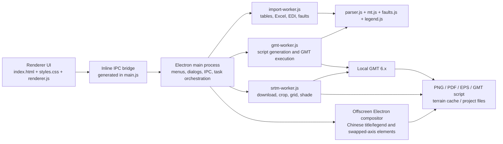

# MT点位图制作工具—GMT 项目接手指南 / Project Handoff Guide

> 最后核对日期 / Last verified: 2026-09-02 ｜ 正式产品线 / Primary product line: Electron + Node.js + GMT 6.x ｜ 本文用途 / Purpose: 让新开发者不依赖历史聊天记录即可继续开发、测试、打包和发布。

## 1. 一页接手摘要 / Executive Summary

`MT点位图制作工具—GMT` 是一个面向大地电磁 MT/AMT/LMT 数据的跨平台桌面制图软件。Electron 提供桌面界面，Node.js 负责数据解析和后台任务调度，GMT 6.x 负责最终制图。软件支持点位表与 EDI 数据导入、点位图、走向图、相位张量、感应矢量、视电阻率/相位曲线、地形底图、构造线、图例、工程文件和多格式导出。

The application is a cross-platform MT/AMT/LMT mapping workbench. Electron provides the desktop UI, Node.js handles parsing and background orchestration, and GMT 6.x performs the final rendering.

接手时必须先知道的事实：

- GitHub 仓库：<https://github.com/SC123667/mt-point-map-gmt>
- GitHub 默认分支：`main`
- GitHub 最新正式版：`v1.1.3`，发布页：<https://github.com/SC123667/mt-point-map-gmt/releases/tag/v1.1.3>
- 当前本地开发分支：`codex/method-colored-stations`
- 当前本地源码版本：`v1.3.0`（标题/图例可见性与论文点位图样式版本）
- 当前分支基于远端 `main` 的 `a5d97e4`，另含 `v1.2.0` 至 `v1.3.0` 五个尚未发布到 GitHub 的本地版本。
- 本地 `v1.2.1` 功能基线：`385e170`、`b432e6a`；不要误认为这些已经进入公开 `main`。
- 当前权威用户入口：`/Users/cwn/Desktop/所有文件夹/实用app/MT点位图制作工具—GMT.app`，版本 `1.3.0`。2026-09-04 已核对包内版本、ASAR 完整性、深度签名和真实启动路径；“实用app”内只有这一个 GMT 绘图应用。
- 原 `1.1.3`、三个 `1.2.0`、`1.2.1`、本次替换的两个 `1.2.3` App 和旧分发包目录已移到可恢复的 `/Users/cwn/.Trash/MT点位图制作工具—GMT旧版本-20260904-本次替换/`。`/Users/cwn/Applications/MT点位图制作工具—GMT.app` 保留为同哈希的 `1.3.0` 来源副本，但日常应从“实用app”路径打开。
- Electron 是正式分发路线；`mt_gmt_tool/` 和 `run.py` 是早期 Python/Tkinter 原型，不是当前正式安装包入口。
- 当前工作机安装了 `/Applications/GMT-6.5.0.app`。普通 shell 的 `PATH` 中没有 `gmt`，但应用自己的检测逻辑能够找到该路径。
- 本次只整理本地项目和建立本地 Git 回滚点，不会自动推送 GitHub。

## 2. 版本与分支状态 / Version and Branch State

| 项目 | 当前状态 |
| --- | --- |
| 本地源码版本 | `1.3.0` |
| 当前分支 | `codex/method-colored-stations` |
| 远端默认分支 | `origin/main` |
| 远端 `main` 基线 | `a5d97e4` / `v1.1.3` |
| 本地功能标签 | `v1.2.0` 至 `v1.3.0`，尚未推送 |
| GitHub 最新 Release | `v1.1.3`，Latest、非草稿、非预发布 |
| 本机 App | 权威入口为桌面“实用app”内唯一的 `MT点位图制作工具—GMT.app`，已验证 `1.3.0` 并从该路径运行 |

版本号必须同步维护：

- `package.json`
- `package-lock.json` 顶层包版本
- `VERSION`
- `CHANGELOG.md`
- `README.md` 和 `DISTRIBUTION.md` 中的开发版/公开版说明
- 本接手文档中的状态表

不要直接在 `main` 上假定已包含 `v1.2.x–v1.3.x`。正式发布前，应先审阅当前分支相对 `main` 的差异，再根据用户授权合并或推送。

## 3. 产品定位与当前能力 / Product Scope

### 数据导入

- 点位表：TXT、CSV、DAT、TSV、XLSX、XLS。
- EDI：递归扫描文件夹及所有子目录中的 `.edi`。
- 文本编码：UTF-8；导入 worker 和构造线解析还会尝试 GB18030、GBK、Latin-1。
- 自动字段识别：测点名、经度、纬度、测线、高程。
- 手动字段映射：基础字段和 MT 响应字段均可重新指定。
- 坐标：经纬度，以及常见 3 度带高斯-克吕格坐标自动识别和转经纬度。
- EDI 字段：`LAT/LONG`，回退到 `REFLAT/REFLONG`；支持十进制度和度分秒。
- EDI 响应：频率、阻抗张量 `ZXX/ZXY/ZYX/ZYY`、`ZXY.VAR`、`ZYX.VAR`、Tipper `TX/TY`。

### 图件类型

- 点位图 / Station map
- 相位张量主轴或广义电性走向图 / Strike map
- 相位张量椭圆图 / Phase tensor map
- Parkinson/Wiese 感应矢量图 / Tipper map
- 单点视电阻率和相位曲线 / MT response curve

### 图件能力

- 点符号、大小、填充、边线和标签样式。
- 经纬网、图幅、GMT 投影、比例尺和指北针。
- 图例内容、顺序、尺寸、颜色、透明度、边框和位置。
- 构造线/断层线叠加：GMT 多段、BLN、普通 XY/经纬度文本。
- 在线 GMT 地形、SRTM HGT 高分辨率地形、本地 `.grd`/`.nc` 网格。
- PNG 自定义 72–1200 DPI、矢量 PDF、EPS、全部格式和可复现 GMT 脚本。
- 工程保存/打开：`.mtgmt` JSON 工程文件。
- 数据质检：重复测点名、重复坐标、无效坐标、缺失 MT 响应、图幅外测点和跳过的 EDI。
- 筛选：测线、测点名前缀、当前图幅范围、是否有 MT 响应。
- 预览交互：滚轮缩放、Shift 框选放大、拖拽平移、适配窗口。

### `v1.2.x–v1.3.x` 本地分支新增能力

- `stationGroups`：按测点名、测点名前缀、测线名或测线前缀分组，为不同勘探方法设置独立颜色、符号、大小和图例项。
- `swapAxes`：横版笛卡尔图中以纬度为 X、经度为 Y，不修改原始测点坐标。
- `labelNames`：只标注明确指定的测点名，适合端点、电极点或少量关键点。
- 中文图名与中文图例：PNG/PDF 通过 Electron 离屏原生渲染叠加，绕开 GMT PostScript 中文字体限制。
- 互换轴地图使用专用比例尺和方向罗盘；北向右、东向上。
- 互换轴地图的地形网格和光照网格通过派生转置文件绘制，不改动源文件。
- 比例尺和指北针的预览拖动位置会传入最终 PNG/PDF。
- `showTitle`：标题与图例可分别显示/隐藏，快捷参数和完整设置均有入口，并保存到 `.mtgmt` 工程。
- `论文点位图` 预设与新建工程默认样式：论文蓝测点、深色细边框、选择性标签、弱化图框/网格，并默认关闭重复图内标题、单类图例和指北针。

注意：`stationGroups`、`swapAxes`、`labelNames` 目前主要由 `.mtgmt` 工程文件中的 `config` 注入和恢复，UI 中还没有完整的通用编辑器。不要把它们描述为所有用户都能在界面里直接配置的成熟入口。

## 4. 总体架构 / Architecture



核心边界：

- Renderer 负责界面状态、交互、自动预览队列和参数收集。
- Main process 负责窗口、菜单、文件对话框、设置持久化、worker 生命周期和原生叠加。
- Import/GMT/SRTM worker 负责耗时工作，防止主界面被几千个测点、批量 EDI 或高分辨率地形阻塞。
- `gmt.js` 只负责数据文件和 GMT 脚本逻辑；不要把 UI 状态直接塞进该模块。
- `mt.js` 保持纯计算函数，便于单元测试。

## 5. 目录和文件职责 / Source Map

| 路径 | 职责 | 修改注意事项 |
| --- | --- | --- |
| `package.json` | 脚本、依赖、版本、electron-builder 配置 | 发布前与 lock/VERSION 同步 |
| `electron/main.js` | Electron 主进程、菜单、IPC、窗口、worker 调度、设置、原生文字/元素叠加 | 文件较大；新业务优先拆模块 |
| `electron/preload.js` | 预期的安全 IPC API | 当前主窗口没有实际加载它，见技术债务 |
| `electron/renderer/index.html` | 主界面 DOM 和设置面板结构 | 新功能优先进入已有叠加菜单/设置窗口 |
| `electron/renderer/renderer.js` | 前端状态、事件、工程快照、自动预览、导出 | 不要继续无边界堆业务算法 |
| `electron/renderer/styles.css` | 设计 token、布局、macOS/Windows 风格、滚动区 | 同时验证两个平台和小窗口高度 |
| `electron/parser.js` | 点位表、投影坐标、EDI、字段识别和记录构建 | 坐标与 MT 字段回归必须加测试 |
| `electron/mt.js` | 阻抗、视电阻率/相位、相位张量、Tipper 计算 | 尽量保持纯函数 |
| `electron/gmt.js` | GMT 检测、脚本、地形、图件和格式逻辑 | 全平台关键模块，路径/转义需谨慎 |
| `electron/gmt-worker.js` | 后台脚本生成、GMT 运行、取消、Windows ASCII 工作区 | 高 DPI/大数据必须保留 worker 路径 |
| `electron/srtm-worker.js` | SRTM 下载、暂停/恢复/取消、解压、裁剪、网格和阴影 | 注意磁盘、内存、网络和缓存复用 |
| `electron/import-worker.js` | 表格/Excel/EDI/构造线后台导入 | IPC 大结果发送完成后才能退出 |
| `electron/faults.js` | 构造线格式识别、解析和 GMT overlay 文件 | 保留多编码兼容 |
| `electron/legend.js` | 图例条目、样式、GMT legend spec | `stationGroups` 会生成多测点图例项 |
| `electron/native-position.js` | 归一化位置解析和原生元素 CSS 定位 | 与预览拖拽/工程恢复保持一致 |
| `tests/*.test.js` | 正式 Electron/Node 回归测试 | `npm run test:node` 一次运行全部 |
| `mt_gmt_tool/`, `run.py` | 早期 Python/Tkinter 原型 | 不属于 Electron 正式分发，不要混合开发 |
| `scripts/patch-nsis-install-section.js` | 构建前修补 NSIS 安装流程 | Windows 更新修复依赖它，不要删除 |
| `build/installer.nsh` | NSIS 安装前清理/兼容逻辑 | 改动后必须在 Windows 实机验证升级 |
| `scripts/Windows-install-fix.bat` | 用户侧一键清理旧进程/残留并重新安装 | Windows 故障兜底，不要删除 |
| `script/build_and_run.sh` | Codex/macOS 打包运行、调试、日志、验证入口 | `./script/build_and_run.sh --verify` 可做启动检查 |
| `.codex/environments/environment.toml` | Codex 工作区 Run 动作 | 自动生成，通常不手改 |
| `README.md` | 面向用户和 GitHub 的双语介绍 | 公共文档保持中英文 |
| `DISTRIBUTION.md` | 打包与分发说明 | 必须区分本地开发版和公开版 |
| `CHANGELOG.md` | 版本历史 | 逆序记录，发布前不得漏记 |
| `release/` | 本机构建产物 | 已忽略，当前约 819 MB，包含多代旧产物 |

## 6. 关键数据模型 / Data Model

### 测点记录

```js
{
  name: "L001",
  lon: 116.02,
  lat: 45.00,
  line: "L1",
  elevation: 123.4,
  sourcePath: "/path/to/L001.edi", // EDI 时存在
  mtResponses: [
    {
      period: 1.0,
      frequency: 1.0,
      z: {
        xx: { re: 0, im: 0 },
        xy: { re: 0, im: 0 },
        yx: { re: 0, im: 0 },
        yy: { re: 0, im: 0 }
      },
      tipper: {
        x: { re: 0, im: 0 },
        y: { re: 0, im: 0 }
      },
      variance: { xy: 0, yx: 0 }, // EDI 路径
      provided: {
        strike: 0,
        ptAzimuth: 0,
        ptMax: 0,
        ptMin: 0,
        beta: 0
      }
    }
  ]
}
```

表格型 MT 数据按测点名聚合，并按周期升序保存响应。缺失值使用 `NaN` 或空数组，不要在序列化前无条件改成 `0`。

### `.mtgmt` 工程文件

- JSON schema 名：`mt-point-map-gmt-project`
- `schemaVersion`: `1`
- 保存内容：解析结果、全部测点、筛选条件、图件类型、输出目录、地形状态、构造线、图例位置、比例尺/指北针位置、图例标签状态和完整绘图配置。
- 工程文件内会保存构造线、本地地形和输出目录的绝对路径。工程复制到另一台电脑后，这些外部路径可能失效，需要重新选择文件。
- 当前打开工程只检查 schema 名，没有严格迁移器和字段级 schema 验证；新增字段时要提供默认值并保持旧工程兼容。

### `v1.2.x` 工程配置示例

```json
{
  "stationGroups": [
    {
      "id": "mt",
      "label": "MT/AMT",
      "match": { "linePrefixes": ["MTAMT"] },
      "symbol": "c",
      "fill": "#0072B2",
      "size": 0.24,
      "penWidth": 0.35,
      "penColor": "black"
    }
  ],
  "labelNames": ["IP-A", "HD-001"],
  "swapAxes": true,
  "xAxisLabel": "Latitude (N)",
  "yAxisLabel": "Longitude (E)"
}
```

分组按数组顺序匹配；一个测点只进入第一个命中的分组，未命中测点使用全局点位样式。

## 7. 运行时数据流 / Runtime Flows

### 点位表导入

1. Renderer 请求 `file:open`。
2. Main 打开文件对话框。
3. `import-worker.js` 读取文本或 Excel 第一张工作表。
4. `parser.js` 判断表头、分隔符、坐标类型和字段映射。
5. Worker 返回记录、映射和自动范围。
6. Renderer 更新质检、筛选、周期选择和自动预览。

### EDI 文件夹导入

1. Worker 递归寻找 `.edi`。
2. 每个 EDI 解析坐标和响应；0/0、越界或缺失坐标会进入跳过列表。
3. 每 25 个文件或结束时发送进度。
4. Renderer 保留完整记录，并允许导出跳过清单。

### 预览与导出

1. Renderer 通过 `readConfig()` 收集当前配置。
2. 自动预览默认防抖 700 ms；已有渲染运行时只排队一次下一轮预览。
3. `gmt-worker.js` 写 `stations_*.tsv`、overlay、legend 和脚本。
4. Worker 异步启动 GMT，向 UI 报告阶段进度，并支持取消。
5. Windows 在 ASCII 临时工作区运行 GMT，再将结果复制回用户输出目录。
6. 如需中文图名/中文图例或互换轴原生元素，Main 使用离屏 Electron 合成 PNG/PDF。

### 地形

- `20m`、`10m`、`06m`：GMT `@earth_relief_*` 路径。
- `01m`、`30s`、`15s`、`03s`、`01s`：SRTM worker 路径。
- 默认数据服务器：中科大 GMT 镜像 `https://mirrors.ustc.edu.cn/gmtdata`；也支持官方 `oceania` 和自定义地址。
- 本地 `.grd`/`.nc`：直接进入 `grdgradient` 和 `grdimage`，无需联网。
- 地形缓存位于输出目录的 `terrain_cache/`；Windows 另有可复用的 ASCII 地形输入缓存。
- 100 万格点以上提示性能风险，250 万格点以上给出更强警告；当前不会硬性阻止任务。

## 8. UI 信息架构和产品约束 / UI Rules

当前方向是“画布优先、预览优先”：

- 左侧始终保留数据、制图、图层、标注、导出、工具六个工作流入口。
- 数据入口必须能直接找到 TXT/CSV/Excel、EDI 文件夹和示例数据导入。
- 中央地图预览占最大面积。
- 右侧快捷参数默认关闭，点击顶部入口展开；中间内容独立滚动，标题和底部操作保持可见。
- 图件类型和周期是高频操作，保留在顶部。
- 低频或复杂功能进入现有叠加菜单/独立设置窗口，不在主界面无限增加按钮。
- macOS 可使用轻玻璃感，但不能影响对比度；Windows 使用稳定清晰的 Fluent 风格。
- 两个平台的信息架构、功能名称和操作路径保持一致。
- 任何布局改动都要至少验证 `1100 × 720` 最小窗口以及右侧面板滚动。
- 不要因为重新设计 UI 而绕过 import/GMT/SRTM worker。

视觉基线：深海军蓝、地质青绿、冷灰背景、克制阴影和清晰焦点状态。目标是专业科学软件，不是装饰型仪表盘。

## 9. 开发环境 / Development Environment

本机 2026-09-02 验证环境：

- macOS 26.3.1，Apple Silicon arm64
- Node.js `v22.17.0`
- npm `10.9.2`
- Electron `35.7.5`
- electron-builder 实际安装 `26.15.3`，`package.json` 约束为 `^26.0.12`
- xlsx `0.18.5`
- GMT App `6.5.0`：`/Applications/GMT-6.5.0.app/Contents/Resources/bin/gmt`
- Python `3.12.11` + pytest `9.0.2`，仅用于遗留 Python 原型测试

项目没有声明严格的 Node `engines` 最低版本。换机器时以 `package-lock.json` 和 CI/实机测试结果为准，不要把上面的本机版本误写成官方最低要求。

## 10. 常用命令 / Commands

```bash
# 安装依赖
npm install

# 开发运行
npm start

# Electron/Node 回归测试
npm run test:node

# 遗留 Python 原型测试
PYTHONPATH=. python3.12 -m pytest -q tests/test_data_and_gmt.py

# macOS 快速打包并运行
./script/build_and_run.sh

# macOS 打包后启动检查
./script/build_and_run.sh --verify

# macOS DMG + app
npm run dist:mac

# Windows 当前默认架构
npm run dist:win

# Windows 两种正式架构
npm run patch:nsis
npx electron-builder --win nsis portable --x64
npx electron-builder --win nsis portable --arm64
```

`npm start` 是否能真正出图取决于本机 GMT。应用会检查 PATH、Homebrew/MacPorts、`/Applications/GMT-*.app` 和常见 Windows 安装目录。

2026-09-02 本机 `electron-builder` 在 `Documents` 的 FileProvider/扩展属性冷扫描阶段极慢；本次 macOS 验证包改用现有 Electron 35.7.5 App 骨架重打 ASAR，并在非 FileProvider 路径清理扩展属性后进行 ad-hoc 深度签名。最终安装包通过 `codesign --verify --deep --strict`，Info.plist 与 ASAR 内版本均为 `1.2.3`，`ElectronAsarIntegrity` SHA-256 与实际 ASAR 完全一致。该应急打包方式只用于本机验证，正式 DMG/公开 Release 仍应恢复并验证标准 `electron-builder` 流程。

2026-09-04 构建 `1.3.0` 时标准 `electron-builder --mac dir` 再次在同一冷扫描阶段无 CPU、无产物进展，因此停止该进程并沿用上述已验证路径。候选包在 `/tmp` 中重打 ASAR，更新 Info.plist 和 `ElectronAsarIntegrity`，清理扩展属性并重新深度签名。候选包与 `/Users/cwn/Applications` 来源副本通过严格深度验签；“实用app”目标包通过普通深度验签，包内版本为 `1.3.0`，ASAR SHA-256 为 `76d7bbeef4f235fbf7ba25e9b15e6d6fb0edb093080318ceebcafd02b389df14`，并已从目标路径真实启动。该 FileProvider 目标路径在复制后会附加 Finder 信息，因而 `codesign --strict` 报 `resource fork, Finder information, or similar detritus not allowed`；来源副本的严格验签和目标包未变化的 ASAR 完整性共同用于区分扩展属性告警与代码损坏。

## 11. 测试说明 / Tests

| 测试 | 覆盖内容 |
| --- | --- |
| `parser_edi.test.js` | EDI 坐标、文件名站点名、0/0 拒绝 |
| `mt_math.test.js` | 相位张量 `X^-1Y`、alpha/beta、主值、走向、阻抗相位和 Tipper 方位约定 |
| `mt_plots.test.js` | 走向线、相位张量椭圆、GMT 投影感应矢量、响应曲线与曲线标题可见性 |
| `fault_legend.test.js` | 构造线、图例、分组点位、互换轴、地形转置、原生位置、地图标题与论文样式层级 |
| `import_worker.test.js` | 表格、字段映射、EDI 递归/批量解析和 worker IPC |
| `gmt_worker.test.js` | 2500 点 worker 绘图、输出文件和隐藏中文标题不触发原生叠加，使用 mock GMT |
| `srtm_worker.test.js` | SRTM worker、缓存 HGT、网格/阴影交接，使用 mock GMT |
| `ui_workbench.test.js` | DOM ID、数据入口、标题/图例快捷开关、论文默认值、曲线测点按钮/方向键导航、预览修订隔离、右栏默认关闭/滚动、macOS/Windows CSS |
| `test_data_and_gmt.py` | Python 原型点位解析和 GMT 脚本 |

2026-09-02 的基线结果：

- `npm run test:node`：8 组全部通过。

2026-09-04 的 `v1.3.0` 结果：

- `npm run test:node`：8 组全部通过。
- 真实 GMT 6.5.0 + 9 个大同 EDI：默认论文样式、标题/图例/选择性标签/网格重新开启组合均成功生成 PNG。
- `PYTHONPATH=. python3.12 -m pytest -q tests/test_data_and_gmt.py`：`2 passed`。
- 默认 `/usr/bin/python3` 没有 pytest，必须使用装有 pytest 的 Python 3.12 或先建立独立虚拟环境。
- 当前 shell 直接执行 `gmt` 会提示找不到，但应用路径检测能找到 GMT 6.5.0 App。worker 测试使用 mock GMT；本次另用应用的真实检测与执行路径成功生成 PNG（18,560 bytes）和 PDF（9,125 bytes）小样。正式发布前仍需从实际 Electron UI 再做一次人工预览/导出检查。

高风险改动的最低验证：

- parser/EDI/字段：`parser_edi` + `import_worker`。
- 构造线/图例/坐标轴/地形脚本：`fault_legend`。
- renderer/UI：`ui_workbench`，并手动检查 macOS/Windows。
- worker/渲染：`gmt_worker`，再做真实 GMT PNG/PDF。
- SRTM：`srtm_worker`，再用小范围、低分辨率真实缓存测试。
- 发布前：全部 Node 测试、Python 原型测试、`git diff --check`、构建产物版本与架构检查。

## 12. 输出、缓存和本地状态 / Files on Disk

默认输出目录：

```text
~/Documents/MT点位图制作工具—GMT输出
```

典型输出：

- `<outputName>.png`
- `<outputName>.pdf`
- `<outputName>.eps`
- `<outputName>.gmt`（macOS/Linux）或 `<outputName>.bat`（Windows）
- `stations_points.tsv`
- `stations_labels.tsv`
- `stations_group_*.tsv`
- `fault_overlays.tsv`
- `map_legend.txt`
- `terrain_cache/`

持久设置只保存输出目录，文件位置为：

```text
app.getPath("userData")/settings.json
```

不要把 `release/`、`outputs/`、`.npm-cache/`、`.pytest_cache/` 或用户地形缓存提交到 Git。

## 13. 打包和发布 / Packaging and Release

### macOS

- 构建目标：DMG 和目录版 `.app`。
- 当前正式产物面向 Apple Silicon。
- 当前公开 DMG 没有 Apple Developer ID 签名和 notarization，适合本人或可信测试；面向陌生用户分发前必须补签名/公证流程。
- DMG 发布前运行 `hdiutil verify`，并检查包内 `Info.plist` 与 `app.asar` 版本。

### Windows

- 目标：x64 和 ARM64，各包含 NSIS setup 与 portable。
- 内部可执行文件名：`MTPointMapGMT.exe`；产品显示名保持中文。
- Windows 中文路径通过 ASCII 临时工作区规避 GMT/Ghostscript 路径问题。
- Windows 更新曾因旧进程和安装残留失败。`build/installer.nsh`、NSIS patch 脚本和 `Windows-install-fix.bat` 是现有修复链，不能随意删除。
- 发布前用 `file` 或 Windows 工具确认 x64/ARM64 架构，并在对应系统实机测试安装、升级、卸载和 portable。

### GitHub Release

公开 `v1.1.3` 包含 6 个附件：macOS ARM64 DMG、Windows x64 setup/portable、Windows ARM64 setup/portable、SHA256 校验文件。

GitHub 曾把中文附件名规范化为 `MT.GMT-...`。上传后要读取远端真实文件名，再更新 Release Notes 和 SHA256 文件，不能只相信本地文件名。

正式发布顺序：

1. 确认工作区只包含本版本相关改动。
2. 同步所有版本源和中英文文档。
3. 运行完整测试与真实 GMT 冒烟测试。
4. 构建 macOS/Windows 所需架构。
5. 验证 DMG、EXE 架构、包内版本和 SHA256。
6. 更新本机“实用app”副本前先退出旧进程，再核对新 App 版本。
7. 创建本地提交和 annotated tag。
8. 只有用户明确同意上传后，才推送分支/标签并发布 Release。
9. 发布后在线核对 Release 非草稿、Latest 状态、附件数量、大小、digest、README 图片和仓库元数据。

## 14. 已知限制和技术债务 / Known Risks

### 需要优先关注

1. **主窗口安全配置需要迁移。** 当前主 BrowserWindow 使用 `contextIsolation: false`、`nodeIntegration: true`、`sandbox: false`，并由 `main.js` 把 CSS、桥接代码和 renderer 拼进 `data:` URL。`electron/preload.js` 虽存在，但主窗口并未加载它。当前内容是本地可信 UI，风险相对受限，但后续应迁移到真正的 preload + `contextIsolation: true`，并缩小 IPC API；迁移时必须完整回归全部菜单、导入、预览和窗口控制。
2. **`main.js` 和 `renderer.js` 体积较大。** 新增独立能力时优先拆成模块，不要继续把数据算法、窗口逻辑和 UI 状态混在一起。
3. **`v1.2.x–v1.3.x` 尚未公开。** 当前本地分支比远端 main 超前；不得向接手人宣称 GitHub 已经有分组点位、互换轴、标题/图例快捷开关和论文点位图预设。
4. **高级 `v1.2.x` 配置缺少 UI 编辑器。** `stationGroups`、`labelNames`、`swapAxes` 主要从工程 JSON 恢复；要产品化需放进紧凑的独立设置窗口。
5. **原生中文叠加主要覆盖 PNG/PDF。** EPS 仍依赖纯 GMT/PostScript；包含中文图名、中文图例或互换轴原生元素时，EPS 可能缺少这些叠加。发布说明必须如实标注，或后续实现独立矢量叠加方案。
6. **工程外部资源使用绝对路径。** 跨机器移动 `.mtgmt` 后，本地地形、构造线和输出目录可能失效。
7. **没有自动更新通道。** 发布和本机 App 更新目前是人工流程。

### 维护注意

- `release/` 当前积累了多代构建产物，约 819 MB。清理前先确认哪些文件仍用于发布或校验。
- `native/MTPointMapGMT/` 目前只有空目录占位，不是正式实现。
- Python/Tkinter 原型功能远少于 Electron，不要为修复正式 App 而误改 Python 入口。
- 高分辨率地形可能产生大量下载、解压缓存、网格和阴影文件；不要重新引入同步主进程处理。
- Import worker 的结果发送要等待 IPC callback 后再断开，否则大量 EDI 可能出现“退出码 0 但主进程没收到结果”。
- Windows 非 ASCII 路径兼容是历史高风险区，任何 GMT workspace 重构都要保留相关测试和实机验证。

## 15. 修改任务应该去哪里 / Change Routing

| 需求 | 优先模块 |
| --- | --- |
| 新表格/EDI 字段 | `parser.js`、`import-worker.js`、字段映射 UI、测试 |
| 新 MT 算法 | `mt.js`，再由 `gmt.js` 消费 |
| 新图件类型 | renderer 图件状态 + `gmt.js` + legend + worker 测试 |
| 新导入文件类型 | `import-worker.js`，必要时新增独立 parser |
| 新地形源 | `gmt.js` 路由 + `srtm-worker.js` 或新 worker |
| 新构造线格式 | `faults.js` + `fault_legend.test.js` |
| 图例功能 | `legend.js` + renderer 设置 + 原生图例同步 |
| UI 布局 | `index.html` + `styles.css`，尽量少改数据逻辑 |
| 系统菜单/文件对话框 | `main.js` + IPC bridge |
| Windows 安装问题 | NSIS include + patch 脚本 + repair BAT |
| 中文标题/图例、互换轴装饰 | `main.js` 离屏合成 + `native-position.js` |

## 16. 推荐后续顺序 / Recommended Next Work

1. 先审阅 `codex/method-colored-stations` 相对 `main` 的两个功能提交和本次文档提交。
2. 继续用真实 GMT 对 `v1.2.x–v1.3.x` 做互换轴地形、中文图例、PNG/PDF/EPS 的对比导出；点位图的默认/元素开关路径已用 9 个真实 EDI 验证。
3. 为 station groups、轴互换和指定标签增加独立紧凑设置窗口，避免要求用户手改工程 JSON。
4. 为 `.mtgmt` 增加 schema 验证、版本迁移和外部资源丢失提示。
5. 将内联 bridge 迁移到 `electron/preload.js`，开启 `contextIsolation` 并关闭 renderer Node 集成。
6. 增加自动化跨平台构建/测试；至少让 Node 测试在 macOS 和 Windows 都运行。
7. 补 Apple Developer ID 签名和 notarization，再扩大 macOS 公共分发。
8. 完成上述验证后，再决定把 `v1.2.x–v1.3.x` 合并到 main 并创建新 GitHub Release。

## 17. 接手检查清单 / Handoff Checklist

- [ ] 阅读 `README.md`、本文件、`CHANGELOG.md`、`DISTRIBUTION.md`。
- [ ] 运行 `git status --short --branch`、`git branch -vv`、`git log --oneline --decorate -10`。
- [ ] 确认当前本地版本、当前分支和 GitHub 最新 Release 不是同一个概念。
- [ ] 运行 `npm install` 或 `npm ci`，再运行 `npm run test:node`。
- [ ] 用 Python 3.12 运行遗留原型的 2 个测试。
- [ ] 确认应用能检测到 GMT，并用示例数据生成真实 PNG/PDF。
- [ ] 检查 `.mtgmt` 工程里的外部绝对路径是否仍有效。
- [ ] 修改功能前确认属于 renderer、main、parser、MT、GMT、fault、legend 还是 worker。
- [ ] 任何大数据、地形或导出改动都不得阻塞主 UI。
- [ ] Windows 构建必须保留 NSIS 修复链和 ASCII 临时工作区。
- [ ] 发布前同步版本、双语文档、截图、校验文件和本机 App。
- [ ] 没有用户明确授权时，不推送 GitHub、不创建远端 Release。

如果只记住三条：**Electron 是正式产品；worker 边界不能破坏；本地 `v1.2.x–v1.3.x` 尚未进入公开 `main`。**
