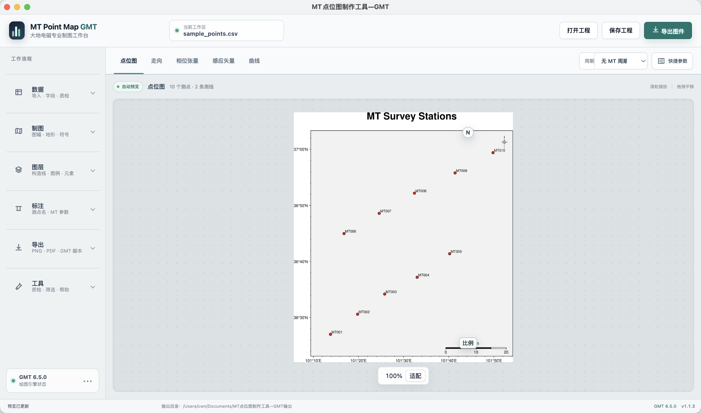
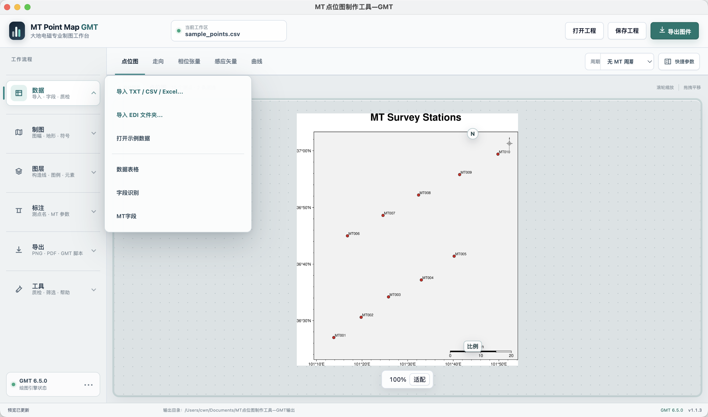
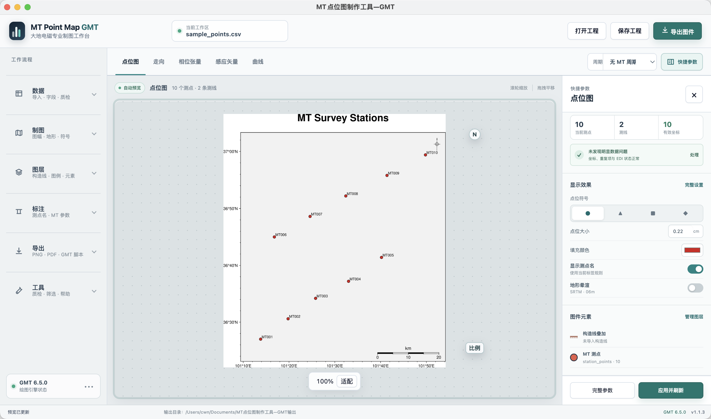

# MT点位图制作工具-GMT / MT Point Map GMT

[](https://github.com/SC123667/mt-point-map-gmt/releases/tag/v1.8.1)
[](https://github.com/SC123667/mt-point-map-gmt/releases)
[](#运行要求--requirements)
[](https://www.generic-mapping-tools.org/)
[](LICENSE)

**MT点位图制作工具-GMT** 是一款面向大地电磁测深（MT/AMT/LMT）野外工作的跨平台桌面制图软件。它把常见 GMT 命令行绘图流程做成图形界面：导入点位表或递归扫描 EDI 文件夹，预览图件，调整论文制图参数，并导出 PNG、矢量 PDF、EPS 和可复现的 GMT 脚本。

**MT Point Map GMT** is a cross-platform desktop application for magnetotelluric (MT/AMT/LMT) field-station mapping and GMT-based geophysical figure production. It turns common GMT plotting workflows into a graphical interface: import station tables or recursively scan EDI folders, preview figures, tune publication-style parameters, and export PNG, vector PDF, EPS, plus reproducible GMT scripts.

关键词 / Keywords: 大地电磁、GMT、地球物理、EDI、相位张量、感应矢量、视电阻率、测点图、magnetotelluric, geophysics, phase tensor, tipper, apparent resistivity.

v1.14.1 修复工作台入口，导出面板首项为 **导出图件 → 直接导出 AI（.ai）**：本机安装 Illustrator 后自动生成原生分层 `.ai`，不再需要手动运行脚本。输出在全局目录的“导出图件/区域”下，同名 AI 会加时间标记，避免覆盖已编辑文件。macOS 首次可能需要允许自动化权限。生成后关闭本次转换文档，恢复 Illustrator 原有文档；耗时绘图继续使用后台 worker。Windows 使用 Illustrator COM 调用，尚未进行 Windows 实机验证。

保留 **AI 编辑包**：在 Illustrator 的“文件 → 脚本 → 其他脚本”运行包内 JSX，生成分层 `.ai`。名称和图例为完整文字；底图、构造线和符号为矢量，地形晕渲仍为影像。编辑版不加文字描边，可在 AI 中重新设置外观。

PDF 请用 Illustrator 的“打开”，置入时可能只是链接或组合对象。EPS 优先通过 Poppler 的 `pdftocairo` 转换；透明区域可能局部栅格化，缺少该工具时会阻止可能导致整页栅格化的转换。普通 PDF/PNG 导出不受此依赖影响。

在 **构造线与图例 → 位置 → 图外下方（两列）** 开启。新建工程默认此位置，旧工程保留原位置；图例自动扩展页面，不缩小地图。PNG/PDF/EPS 一致，原生图外图例不在图中拖动。论文样式增加 2 mm 外边距，并在 GMT 只有两端数字时补上比例尺中点。独立 GMT 脚本保留 GMT 自己的图例排版和比例尺刻度，原生双列样式以应用导出为准。

## 制图工作台（本地 v1.14.1）

左侧选择功能，右侧调整参数，中央保持地图预览。点右侧“更新预览”应用修改，面板保持打开；“展开”可加宽编辑区域。按 **⌘/Ctrl + K** 搜索功能。

- **地图**：范围与投影、地形底图、等高线、制图样式。
- **图层与标注**：本地构造库、地点与构造、查询地理数据、名称与语言、构造线与图例、标题与图件元素。
- **测点与 MT**：展开后导入数据、设置字段、符号、标签及 MT 参数，查看表格和质检。
- **输出与软件**：导出图件、目录与缓存、GMT 引擎、使用帮助。

中英文开关位于 **名称与语言**；构造坐标、样式和来源分别位于构造编辑器的三个页签。右上角“导出图件”打开格式选择，可直接导出 PDF、PNG、EPS 或 GMT 脚本。旧工程继续可打开。详细入口与验证方法见 [工作台说明](docs/UI_WORKBENCH.md)。下文旧版本介绍中的菜单路径，以当前侧栏和功能搜索为准。

## GMT 6.7 引擎适配（v1.10.0 起）

当前本地源码版本 **v1.14.1**，GitHub 公开版本仍为 **v1.8.1**。点击左侧 **GMT 引擎**，可自动优先选择 GMT 6.7、手动选择保留的 6.5/6.6，或浏览其他安装路径。指定路径失效会明确提示，不悄悄切换版本。引擎选择随全局工作区保存；工程记录版本信息，打开工程不会套用其他电脑的程序路径。

默认安装 GMT **6.7.0**。macOS 使用现有 Homebrew 安装 GMT 与 Ghostscript，安装前核对 6.7 分支；没有 Homebrew 时提供安装说明。Windows 下载官方 6.7.0 x64 安装器。安装日志和缓存归入全局目录“安装包/GMT-6.7”。GMT 不内置于本 App。

导出目录增加 `GMT运行信息.json`，生成脚本注明 GMT 版本。macOS GMT 6.7.0 已验证 Mercator/Lambert、全球 Robinson、南北极立体投影、跨日期变更线、中英文 PNG/PDF/EPS 和五类 MT 图件；旧 GMT 6.5 地形出图回归通过。Windows 实机及 GMT 6.6 本轮未验证。

## 论文构造地形图（v1.9.0）

打开“图层 → 本地构造库”，点击“论文构造地形图”；也可以在绘图预设中选择“论文浅灰底图”。浅色地形、弱阴影、分类构造线、较短比例尺与统一字体一起应用，构造类别选择、坐标、高程分辨率和工程数据保持原有设置。

“图层 → 地点与构造”提供名称语言、自动排布和隐藏文件编号开关。排布根据投影后的图幅尺寸选择线上的标注位置与角度，去除重复名称，避免文字互相遮挡和越出图框。放不下或没有可靠名称的对象仍绘制几何；遗漏原因写入输出目录的 `标注排布报告.json`。手动标注锚点优先保留，过密图件仍需按来源/类别筛选及最终人工审阅。

论文预设保留已选中文或英文；原始名称模式转为统一中文。PDF 中文字、构造线和等高线保持矢量，晕渲底图仍是栅格。具体配色与适用边界见 [构造图使用说明](docs/CARTOGRAPHY.md)。

## 本地构造库自动叠加（v1.8.0）

打开“图层 → 本地构造库 · 自动叠加”，选择构造文件夹。程序复制、校验并缓存原文件，后台识别 GMT/DAT/XY/BLN、GeoJSON、SHP、KML 构造，处理 GB18030 中文和重复数据。勾选“叠加本地构造”后，每次预览、导出或保存 GMT 脚本都会按当前图幅重新匹配；不需要重复导入。可选类别、来源、颜色、线宽和名称开关，沿用统一中英文设置。

缓存保存在全局目录 `构造数据/本地构造库`：原始文件、标准化数据、空间索引、复制校验清单和历史文件分类保存。读取只依赖缓存，原目录移走不影响绘图。缓存文件变化会增量更新索引；原目录的新文件需点击“选择 / 同步构造文件夹”。参考文献、色带、脚本、行政区划和 backup 备用数据不会当作构造自动绘制。ZIP 保留为原始附件，本地构造库使用解压后的数据。

自动叠加设置随工程保存；构造几何按图幅读取，不累积到工程。需要单独改节点、译名或样式，可点击“转为可编辑图层”，复制当前范围的构造到“地点与构造”并关闭自动叠加。整套源数据继续保留。导出 PDF/EPS 的构造线为矢量；不同作者的近似线不自动合并，可按来源取消。

The offline tectonic library copies and checksums local datasets, indexes geometries in a background worker, and automatically selects intersecting features for each map extent. Toggle the overlay, choose categories/sources and styles, or convert the current extent into editable layers. Cached data is independent of the original folder; project files preserve overlay settings. No network download is required for this library.

## 构造节点编辑与统一中英文（v1.7.0）

打开“图层 → 地点与构造”：点击“在地图上画构造线”或“在地图上画构造区域”，依次点击地图，完成后填写名称。已有对象可“拖动当前对象节点”，在线段附近点击插入节点，也可删除节点、撤销。多段线和带孔区域保留原来的组成关系；手工调整会记录来源信息。编辑前需先生成地图预览。

面板顶部可选择“统一中文 / 统一英文”和“完整名称 / 简称 / 完整名称 + 简称”。软件按原始双语字段和内置常用名称表整理名称；缺少可靠译名时保留构造几何、暂不显示该名称，并列入待补全。用户可以编辑双语名称（支持换行）、类别图例名称，并将修订保存到全局 `名称词典/用户中英文名称.json`，下次导入同一对象复用。旧工程保留原始名称模式，避免改变已有出图。

“查询构造 / 城市数据”新增公开构造联合查询与点/线/区域筛选，IYZS 等已知简称可匹配真实构造线。数据源没有提供某条构造时，需要导入其他可靠矢量或手工描绘；软件不会根据单个名称点猜测边界。

## 地点、构造数据与等高线

先选择“区域底图”并设置经纬度范围，然后打开左侧“图层”：

- **地点与构造**：输入名称及坐标；选择点、线或面。地点可从 Excel 批量粘贴，构造可导入 GeoJSON、SHP/ZIP、GMT/XY。编辑名称、简称、字体、符号、填色和偏移后保存对象。
- **查询构造 / 城市数据**：选择 HimaTibetMap、GEM、PB2002、离线城市或地质 WFS，按名称及当前范围查询，勾选后添加。批量构造默认关闭名称，避免遮挡；可统一开启同类标签。
- **等高线**：独立启用，设置等高距、主等高线、高程数字和间隔。高程数据来自“地形底图”选择的来源或本地 GRD。

所有图层和样式随 `.mtgmt` 保存；导出的 PDF 可在 Illustrator 中继续编辑文字、线条和符号，地形晕渲仍为影像。构造缓存放在全局目录的 `构造数据`，图件与可编辑 SVG/GeoJSON 放在 `导出图件` 的地名及范围目录。

数据入口分为直接下载、WFS 服务和官网申请后导入。中国活动断层中心、地质云及 OneGeology 各服务的权限与覆盖范围不同，软件不会把 WMS 图片伪装成构造矢量。详见 [构造图使用说明与来源](docs/CARTOGRAPHY.md)。

## 项目接手 / Developer Handoff

完整的架构、版本状态、模块职责、数据流、测试、打包、发布和技术债务说明见 [PROJECT_HANDOFF.md](PROJECT_HANDOFF.md)。当前发布版本为 **v1.8.1**，包含此前本地 v1.2.0–v1.8.0 的累积更新。

See [PROJECT_HANDOFF.md](PROJECT_HANDOFF.md) for the complete architecture, branch state, module ownership, runtime flows, testing, packaging, release process, and known technical debt. The current release is **v1.8.1**, including the cumulative v1.2.0–v1.8.0 updates.

## 高精度地形下载 / High-resolution terrain

在“地形底图”选择 1 分、30 秒、15 秒、3 秒或 1 秒时，使用“高精度下载源”：**USTC 中国镜像（推荐）**或 **AWS 全球源**。USTC 通过 App 内置解码器处理，不需要额外安装 JP2/GDAL 插件；更低分辨率使用独立的 GMT 下载源。

切换源前先取消当前任务，再点击“下载/准备底图”。已完成的高程瓦片可复用，未完成瓦片需重新下载；工程文件保存下载源选择。降低输出分辨率主要减少计算量，这些 SRTM 选项仍下载完整原始瓦片。缓存优先：更换源不会强制重下已经准备好的底图。

For 1m through 1s terrain, select USTC or AWS in the high-resolution source selector. USTC JP2 decoding is bundled and runs in the SRTM worker. Cancel an active task before changing sources; completed HGT tiles remain reusable. Lower output resolution reduces processing rather than the original tile download size. Lower-resolution terrain retains its separate GMT server selector.

## 软件界面 / Interface Preview

### 画布优先工作台 / Canvas-first Workbench



1.1.3 工作台采用画布优先布局：左侧常驻数据、制图、图层、标注、导出和工具入口，右侧快捷参数默认收起，让中央地图获得最大空间。

The 1.1.3 workbench uses a canvas-first layout: data, mapping, layer, label, export, and utility entry points stay visible on the left, while the contextual quick inspector stays collapsed by default so the central map receives maximum space.

### 就近导入数据 / Direct Data Import



TXT/CSV/Excel、EDI 文件夹和示例数据都可直接从左侧“数据”菜单进入，原有系统文件菜单与快捷键仍然保留。

TXT/CSV/Excel tables, EDI folders, and sample data are directly available from the left Data menu, while the native File menu and shortcuts remain available.

### 可滚动快捷参数 / Scrollable Quick Inspector



右侧快捷参数按需展开，中间参数区支持鼠标滚轮、触控板和键盘滚动；顶部标题与底部操作始终可见，不会压缩成难以操作的长面板。

The contextual quick inspector opens on demand. Its middle content supports mouse-wheel, trackpad, and keyboard scrolling, while the title and bottom actions remain reachable.

## 为什么做这个工具 / Why This Tool

大地电磁野外和论文制图经常需要快速制作点位分布图、测线图、带地形底图的图件、相位张量图、感应矢量图和单点曲线图。直接写 GMT 脚本很强大，但重复劳动多，也不适合频繁调参数。本软件保留 GMT 作为制图引擎，同时提供桌面界面，让常用 MT 图件可以更快生成和复现。

MT field work often needs quick station maps, line maps, terrain-backed figures, phase tensor maps, tipper maps, and single-site sounding curves. GMT scripts are powerful but repetitive when parameters change frequently. This app keeps GMT as the rendering engine while providing a desktop UI for routine MT plotting.

## 主要功能 / Highlights

- 导入 TXT、CSV、DAT、TSV、XLSX、XLS 点位表。
- Import TXT, CSV, DAT, TSV, XLSX, and XLS station tables.
- 从左侧数据菜单直接导入点位表、EDI 文件夹或示例数据，无需在界面中寻找隐藏入口。
- Import station tables, EDI folders, or sample data directly from the persistent Data menu.
- 递归扫描文件夹中的 `.edi` 文件，读取测点坐标和可用的 MT 响应数据。
- Recursively scan `.edi` folders and extract station coordinates plus available MT response data.
- 自动识别测点名、经度、纬度、测线、高程等字段，也支持手动指定列含义。
- Auto-detect station name, longitude, latitude, line, and elevation columns, with manual column mapping.
- 支持经纬度坐标和常见 3 度带高斯投影野外坐标。
- Support longitude/latitude tables and common 3-degree Gauss projected field coordinates.
- 绘制 MT 点位图，支持标签、符号、经纬网、比例尺、指北针。
- Draw MT station maps with labels, symbols, grid, scale bar, and north arrow.
- 支持 GMT 在线/缓存地形晕渲底图，也支持导入本地 GMT `.grd`/`.nc` 地形网格。
- Support GMT online/cache shaded-relief basemaps and local GMT `.grd`/`.nc` terrain grids.
- 支持导入构造线/断层线文件并作为 GMT 叠加层绘制，可为图件生成简洁图例。
- Import structural or fault-line files as GMT overlays, with optional compact legends.
- 支持可编辑图例、比例尺、指北针位置和图件元素。
- Support editable legend content plus draggable legend, scale-bar, north-arrow, and map-element placement.
- 标题和图例可分别显示/隐藏；内置“论文点位图”预设会减少重复标题、无信息量图例和密集全标签。
- Toggle title and legend independently; the publication station-map preset removes repeated titles, uninformative legends, and dense all-site labeling.
- 绘制相位张量主轴（alpha - beta）/ 广义电性走向图。
- Draw phase-tensor principal-axis (alpha minus beta) / generalized electric-strike maps.
- 绘制相位张量椭圆图。
- Draw phase tensor ellipse maps.
- 绘制 Tipper 感应矢量图，支持 Parkinson / Wiese 约定。
- Draw Tipper induction vectors with Parkinson / Wiese convention choices.
- 从 EDI 阻抗张量绘制视电阻率和相位曲线。
- Draw apparent-resistivity and phase sounding curves from EDI impedance tensors.
- 曲线测点支持下拉、上一点/下一点按钮和键盘左右方向键切换。
- Switch response-curve stations from the selector, previous/next buttons, or left/right arrow keys.
- 预览区支持滚轮缩放、框选局部放大、拖拽平移。
- Preview supports mouse-wheel zoom, box zoom, and drag-to-pan.
- 导入、GMT 渲染和 SRTM 地形准备使用后台 worker，减少大数据和高分辨率任务对界面的阻塞。
- Import, GMT rendering, and SRTM terrain preparation use background workers to keep large-data and high-resolution tasks responsive.
- 支持 PNG 自定义 DPI、矢量 PDF、EPS、全格式导出，并保存可复现 GMT 脚本。
- Export PNG with custom DPI, vector PDF, EPS, all formats, and reproducible GMT scripts.
- 支持 macOS 和 Windows 打包分发。
- Build distributable macOS and Windows desktop packages.
- 支持按勘探方法分组样式、经纬轴互换、指定测点标注、原生中文图例、标题/图例独立开关和论文点位图样式。
- Includes method-based station styling, swapped geographic axes, explicit label selection, native Chinese legends, independent title/legend visibility, and a publication station-map style.

## 正式版下载 / Stable Release

当前版本 **v1.8.1**。下载与你电脑架构对应的安装包，安装 GMT 6.x 后即可绘图。新用户默认数据目录为 `~/Documents/GMT工作区`；缓存、导出和工程在其中分类保存，无需开发者的外接硬盘。

Current version: **v1.8.1**. Choose the matching installer and install GMT 6.x separately. New users store generated files under their own `~/Documents/GMT工作区`.

macOS 包采用 ad-hoc 签名，未做 Apple 公证。如系统阻止打开，可在“系统设置 → 隐私与安全性”中确认允许此应用。Windows 包未作商业代码签名；本次没有 Windows 实机安装/升级验证。个人构造库、地形缓存、工程和用户名称词典不随安装包分发；可自行导入或通过软件的公开数据入口获取。

The macOS package is ad-hoc signed, not notarized. Windows packages are unsigned and have not been tested on physical Windows systems in this release. Personal datasets, projects and user dictionaries are not bundled. See [Distribution](DISTRIBUTION.md) for validation limits.

[打开 GitHub Releases / Open GitHub Releases](https://github.com/SC123667/mt-point-map-gmt/releases)

- macOS Apple Silicon: `.dmg`
- Windows x64: setup installer and portable package
- Windows ARM64: setup installer and portable package

## 图件类型 / Figure Types

- 点位图 / Station map
- 走向图 / Phase-tensor principal-axis or generalized electric-strike map
- 相位张量 / Phase tensor ellipse map
- 感应矢量 / Tipper or induction vector map
- 电阻率和相位曲线 / Apparent-resistivity and phase sounding curve

## 无测点区域底图与 Illustrator 编辑 / Region-only Maps and Illustrator

1. 点击顶部 **区域底图**，或左侧 **制图 → 按经纬度范围绘图**。
2. 填写西、东、南、北四个边界，例如经度 `115–125°`、纬度 `20–30°`，点击 **确认并更新预览**。无需导入测点。
3. 可继续设置投影、经纬网、地形、构造线、标题和比例尺，也可保存为 `.mtgmt` 工程。
4. 点击 **导出图件 → 直接导出 AI（.ai）**，软件会调用已安装的 Illustrator 保存分层文件。也可导出矢量 PDF，在 Illustrator 中选择 **文件 → 打开**，随后另存为 `.ai`。线条、图框、文字和填充保留为矢量对象；可能需要取消编组或进入剪切组编辑。字体编辑取决于本机字体。

区域底图模式不绘制已导入测点，但会保留数据，切回点位图即可继续使用。坐标采用十进制度，西经/南纬为负数；跨日期变更线可使用 `170/190/-10/10`，墨卡托投影不包含南北极。

Select **Region basemap**, enter west/east/south/north bounds, and confirm to preview without station data. Save/reopen `.mtgmt` projects or export vector PDF/EPS. Open the PDF in Adobe Illustrator to edit paths and text and save as `.ai`; groups or clipping masks may need to be entered or released, and editable fonts depend on local availability.

**矢量范围说明：** 地形晕渲属于栅格影像，不会自动变成可逐条编辑的等高线。PDF 中的中文标题/图例采用矢量合成，保持 GMT 底图可编辑；v1.6.0 起应用导出支持原生中文 EPS 合成，中文编辑仍优先选 PDF。软件不直接生成 Illustrator 专有 `.ai` 文件，也不恢复为带图层名称的 GIS 工程。

**Vector scope:** Shaded relief remains a raster image. Chinese PDF decorations preserve the GMT vector base; App exports since v1.6.0 also compose native Chinese EPS decorations. The app exports PDF/EPS, not native `.ai` or named GIS layers.

## 输入数据 / Input Data

### 点位表 / Station Table

推荐 CSV 格式 / Recommended CSV:

```csv
station,lon,lat,line,elevation
A01,101.23,36.45,L1,1850
A02,101.51,36.62,L1,1878
```

支持中文表头 / Chinese headers are supported:

```text
测点 经度 纬度 测线 高程
A01 101.23 36.45 L1 1850
A02 101.51 36.62 L1 1878
```

没有表头也可以导入，软件会根据数值范围自动推断坐标列。  
Tables without headers are also accepted. The app infers coordinate columns from numeric ranges.

### 高斯投影坐标 / Gauss Projected Coordinates

支持野外常见的 3 度带高斯投影米坐标，例如 / Common 3-degree Gauss projected field files are supported:

```text
点号 北向坐标/m 东向坐标/m
线距200 m点距20 m
L3401 38515597.72 4079993.372
L3402 38515597.72 4080013.372
```

类似 `38515597.72` 的数值会在合适情况下按带号前缀高斯坐标处理并自动转经纬度。  
Values such as `38515597.72` are interpreted as belt-prefixed Gauss coordinates when appropriate and converted to longitude/latitude.

### EDI 文件夹 / EDI Folder

通过左侧 `数据 > 导入 EDI 文件夹`（或系统菜单 `文件 > 导入`）选择目录，软件会扫描该目录及所有子目录下的 `.edi` 文件，读取坐标、频率/周期、阻抗张量、Tipper 等可用字段。

Use `Data > Import EDI Folder` in the left workflow menu (or `File > Import`) to scan every `.edi` file in a directory and its subfolders. The parser reads coordinates, frequency/period arrays, impedance tensors, Tipper data, and other available fields.

### 本地地形网格 / Local Terrain Grid

在地形底图模块中可以导入本地 GMT 网格文件 / In the terrain panel, local GMT grid files can be imported:

- `.grd`
- `.nc`

软件会直接调用 GMT `grdgradient` 和 `grdimage` 使用该网格，不需要联网下载地形数据。  
The app uses the selected grid directly with GMT `grdgradient` and `grdimage`, so no online terrain download is required.

## 运行要求 / Requirements

- 需要安装 GMT 6.x，预览和导出图件依赖本机 `gmt` 命令。
- GMT 6.x is required; preview and export rendering depend on the local `gmt` command.
- 桌面程序支持 macOS 和 Windows。
- The desktop app supports macOS and Windows.
- 从源码开发或打包需要 Node.js。
- Node.js is required for development and packaging from source.

软件可以自动检测 GMT，并在支持的平台提供安装/下载入口。没有 GMT 时仍可导入数据和保存 GMT 脚本，但不能生成预览和正式导出图。  
The app can detect GMT and provides installer/download entry points on supported platforms. Without GMT, data import and GMT script saving still work, but preview/export rendering is unavailable.

## 开发运行 / Development

```bash
npm install
npm start
```

## 测试 / Tests

```bash
npm run test:node
```

## 打包 / Build

macOS:

```bash
npm run dist:mac
```

Windows:

```bash
npm run dist:win
```

打包产物输出到 `release/`。  
Release artifacts are written to `release/`.

## 输出文件 / Output

默认输出目录 / Default output directory:

```text
~/Documents/GMT工作区/导出图件
```

常见输出 / Typical files:

- `mt_point_map.png`
- `mt_point_map.pdf`
- `mt_point_map.eps`
- `mt_point_map.gmt`
- 中间点位文件和地形文件 / intermediate station and terrain files
- 构造线叠加和图例中间文件 / structural-line overlay and legend intermediate files

## 技术栈 / Technology

- Electron 桌面程序 / Electron desktop app
- GMT 命令行制图 / GMT command-line rendering
- Node.js 数据解析 / Node.js data parsing
- Excel 表格导入 / XLSX table import
- EDI 坐标与响应数据解析 / EDI coordinate and response parsing
- 本地 GMT 地形网格支持 / Optional local GMT terrain grids

## GitHub 主题词 / Repository Topics

建议主题词 / Suggested topics:

`magnetotelluric`, `gmt`, `geophysics`, `edi`, `phase-tensor`, `tipper`, `apparent-resistivity`, `earth-science`, `electron`, `mapping`

## 许可证 / License

MIT License. See [LICENSE](LICENSE).

### v1.5.0 全局工作目录与地形加速

v1.8.1 起新用户统一使用 `~/Documents/GMT工作区`，也可通过 `MT_GMT_WORKSPACE` 或目录链接指定其他磁盘。`导出图件`、`预览文件`、`工程文件`、`导出表格`、`导出脚本`、`地形缓存`、`安装包`、`运行数据`、`运行日志` 和 `临时文件` 各自分类。原始导入文件保持原位置。地形设置中可查看和打开全局目录，也可填写区域名称；自动命名使用随 App 附带的 GeoNames 城镇数据（CC BY 4.0），无须联网查询位置。

同一区域的高程跨工程/导出目录共享，改变阴影强度只生成新阴影。1 秒原始瓦片最多 3 块并行下载，直接写二进制高程，避免几十 GB 文本中间文件。宽区域预览按屏幕大小选择较低分辨率，正式导出保持用户选择的地形源分辨率；PDF/EPS 中的地形晕渲按 DPI 嵌入影像，图框、文字和线条保留矢量。

外接盘未连接或不可写时会提示，不会悄悄写回系统盘。可通过 `MT_GMT_WORKSPACE` 环境变量指定全局目录；macOS 和 Windows 默认 `Documents/GMT工作区`，GMT 的 ASCII 兼容入口通过目录联接指向该目录。Windows 修改尚需在 Windows 实机回归。

迁移执行器：`node scripts/migrate-workspace.cjs --apply 已审核的计划.json`。每条计划含 `source` 和 `target`，复制后校验 SHA-256，并保留旧路径兼容链接；日志用于核对和恢复。不要未经授权清理旧数据或迁移记录。
